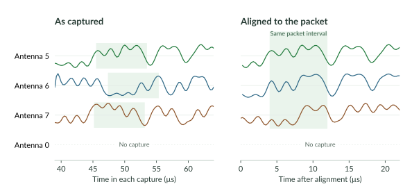
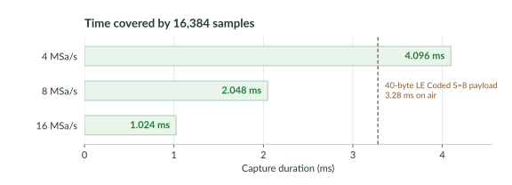

BLE reception
=============

.. warning::

   Bluetooth reception is experimental and under development.
   The associated demos are unstable, and the API will change without notice.

BLE mode captures raw IQ from each sensor's radio. Use it to discover
nearby advertisers, record Bluetooth LE packet waveforms, or estimate
where a packet came from.

   One advertisement captured on channel 37 at 4 MSa/s. The highlighted
   interval occurs about 2.2 µs later in one capture than another.
   Alignment puts it at the same time on all three traces. Antenna 0
   returned no report. The traces show normalized baseband I.

What the array can receive
--------------------------

* **Advertising and connection packets.** Receivers can identify packets
  with arbitrary valid access addresses. Advertising CRCs can be checked
  using the known initializer. For connection packets with an unknown
  initializer, the array reports the access address and packet prefix with
  the CRC unverified. It does not join connections or decrypt payloads.
* **One channel per board.** All its BLE sensors listen on the selected
  channel. The array stays there until you retune it. It does not follow
  connection hopping or the secondary-channel pointers in extended
  advertisements.
* **LE 1M, LE 2M and LE Coded.** Use **LE 1M / Coded** for LE 1M and
  LE Coded S=2 or S=8, and **LE 2M** for the faster PHY. A packet must
  fit in the capture window for full CRC verification.
* **Direction from ordinary packets.** A transmitter does not need a
  Constant Tone Extension (CTE) or a special tag. ESPARGOS compares the
  modulated waveforms from the same packet across calibrated antennas.
  One board can estimate direction of arrival. Finding a position
  requires additional measurements or known geometry.

How raw IQ capture works
------------------------

Select BLE mode on the sensors. The radio stays tuned while each sensor
keeps a rolling history of raw I/Q samples at a 2 MHz intermediate
frequency, before packet demodulation. A burst detector saves a window
around a candidate packet. The sensor uses the BLE modem for automatic gain
control. Its IQ recorder detects bursts independently of the modem's
advertising address match.

The sensor normally checks that the waveform looks like BLE before
reporting its samples, timestamps and gain. The controller forwards those
packet-sized reports to your computer. In Python, ``board.ble`` delivers
each sensor's reports, and ``pool.ble`` groups matching packet fields and
capture times into a ``BLECluster``. One qualified report can identify a
packet. For direction finding, use the cluster to compare the same
transmission across antennas.

Find nearby advertisers
-----------------------

In the browser, select array mode **BLE** and open **Bluetooth LE**.
Select **LE 1M / Coded** and one of the primary advertising channels
(37, 38 or 39). Use an antenna input for over-the-air packets.

Leave the sample rate on Auto to start. It uses 4 MSa/s for
**LE 1M / Coded** and 8 MSa/s for **LE 2M**. This Python example listens
on channel 37 and prints the address and name of each advertiser it sees.

.. code-block:: python

   from espargos import Pool

   def show_advertiser(cluster):
       packet = cluster.packet
       if packet.is_advertisement and not cluster.is_calibration:
           print(packet.advertiser, packet.name)

   with Pool("192.168.1.2") as pool:
       pool.configure(mode="ble", channel=37, output="antenna_r")
       receiver = pool.ble
       receiver.apply_config({"phy": "LE1M", "decimation": 0})  # Auto
       receiver.add_callback(
           show_advertiser, callback_predicate=lambda cluster: True
       )
       pool.start_processing()
       input("Listening for BLE advertisements. Press Enter to stop. ")

The predicate delivers the first qualified report for each event. The default
callback waits for all selected BLE sensors on the originating board. Pass
``include_partial=True`` to also receive incomplete events once they have had
time to collect more reports. Closing the pool ends the subscription. The
configured radio settings remain in place.

Packet reports and CRCs
-----------------------

For LE 1M and LE 2M, Python uses the identity and CRC result that the sensor
reports. For LE Coded, the sensor recognizes the preamble and Python decodes
the packet from its IQ. To inspect bursts that fail the sensor's packet check,
use ``receiver.apply_config({"sensor_filter": False})`` and subscribe on the
board. To save the original sensor record for later, use ``bytes(packet)``.
See :doc:`packet-decoders` to call the decoder directly.

Use ``packet.samples`` for the complex ADC samples in capture order.
``packet.sample_rate`` and ``packet.if_hz`` describe the recording. Use
``receiver.packet_iq(cluster)`` when you need samples aligned across antennas.

* ``packet.qualified`` means the receiver found a packet it could identify.
  Check ``packet.crc_valid`` separately to confirm its CRC. The record keeps up
  to 32 decoded bytes, so the advertising name may be absent or incomplete.
* ``cluster.board_index`` identifies the board that saw the event.
  ``cluster.get_packet(cluster.board_index, antenna_id)`` returns that
  antenna's packet or ``None``. Two boards in one pool report events
  independently. BLE events and phase estimates are board-local.
* ``board.ble.subscribe_packets(callback)`` delivers
  ``SensorMessage[BLEPacket]`` records, including received candidates that
  could not be decoded. Keep its handle and pass it to
  ``board.ble.unsubscribe(handle)`` to detach.

For a bounded recording, create a ``BLEBacklog`` before processing starts::

   from espargos import BLEBacklog

   backlog = BLEBacklog(receiver, fields=["packets", "completion"],
                        include_partial=True, size=100)

Then run pool processing as in the discovery example.
``backlog.get("packets")`` returns a snapshot, with ``None`` for missing
sensor reports. Call ``backlog.close()`` when you are done recording.

Sample rate and packet length
-----------------------------

   The example coded packet fits at 4 MSa/s. At 8 or 16 MSa/s, its
   airtime alone exceeds the capture window.

Long packets can outlast the capture after allowing for margins. This matters
most for LE Coded, where CRC verification needs the entire coded packet,
including the FEC termination. The **LE 1M / Coded** setting captures both
1 Msymbol/s formats. ``packet.phy`` identifies the decoded PHY,
``packet.coding`` gives the coding factor (0, 2 or 8), and ``packet.capture_phy``
identifies the modem setting used during capture.

Phase and calibration
---------------------

For uncalibrated phase, call ``receiver.phase(cluster, calibrated=False)``.
The result contains unit phasors, coherence and a validity mask in array order.
Use the mask to exclude sensors with insufficient or incoherent waveform
data. With automatic gain, calibrated phase also needs a stable measured
gain for each packet.

To use the built-in LE 1M reference, choose **LE 1M / Coded** and set
**Reference Generation** to **During Calibration** in **Bluetooth LE
Settings**. Put all eight sensors on the board in BLE mode and start pool
processing, then call ``receiver.calibrate(board_index=0)``. The call
uses the REF input, then restores the original input. Automatic gain switches
to manual during the measurement. Expert gain keeps the selected gain words.
Each sensor needs enough advertisements in common with the reference antenna.
Different sensors can use different advertisements. If calibration times out at
16 MSa/s, try the automatic sample rate and calibrate again.

For LE 2M calibration, feed an external LE 2M advertisement to the
reference network on the selected channel. Pass its advertiser MAC as
``reference_address``. See :doc:`calibration` for reference routing and
broadband or cross-board calibration.

Use ``receiver.apply_config()`` for live changes. Ordinary gain changes, RF
input changes and changes to sample rate preserve a compatible correction.
Channel, PHY, expert gain settings and receiver or clock restarts require a new
reference measurement. Direct board changes bypass this check, so invalidate
the receiver's calibration before using corrected phase again.

Alignment and beamforming
-------------------------

The offsets in the figure describe where the packet lands in each capture
window. The direction estimate uses RF phase after compensating for those
offsets. Call ``receiver.packet_iq(cluster, calibrated=False)`` for aligned
samples. With the default ``calibrated=True``, the method also applies each
sensor's reference correction. Missing or poorly aligned captures stay out
of the phase estimate.

``iq.covariance()`` uses the overlap for each antenna pair. This preserves
samples from longer captures even if a third antenna captured less of the
packet. To combine measurements from several packets, combine their
covariances. Each packet can have a different common phase::

   iq = receiver.packet_iq(cluster)
   phase = iq.phase()
   covariance, sample_counts = iq.covariance()

* Use ``receiver.channel_response(cluster)`` for relative response across
  the BLE band. ``group_delay()`` estimates a phase slope where the
  waveform has enough power and coherence. The result is useful for
  comparing paths and is too narrowband for precision ranging.
* Use ``BLEBeamformer`` for Bartlett, MUSIC or Root-MUSIC. Pass the
  originating board's phase, covariance, sample counts and actual channel
  frequency. The result contains a spectrum or fitted directions.
* If you select random polarization, use ``cluster.rf_switch_state`` for each
  sensor's actual antenna feed. ``BLEPhaseHistory`` keeps observations for
  one source and pairs measurements from the same polarization. Its
  ``coherent_feeds()`` method needs overlapping observations that connect
  both feeds across the array. ``phase.amplitude`` supplies gain-normalized
  values for comparing the feeds.

The BLE demos under ``demos/ble`` show discovery, phase by antenna and
relative channel response. They use the same receiver API.
