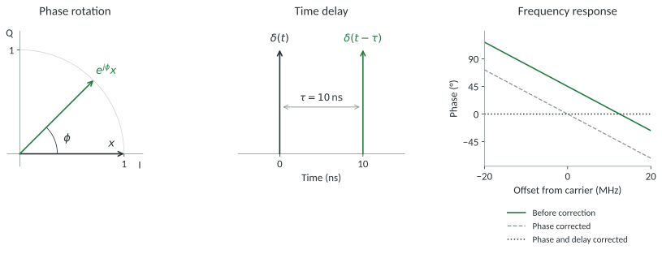
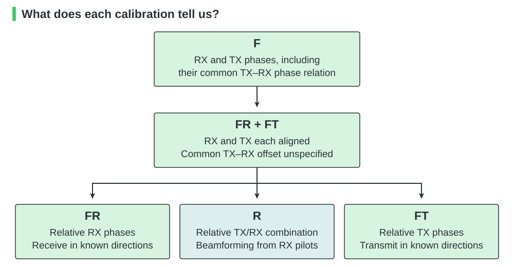
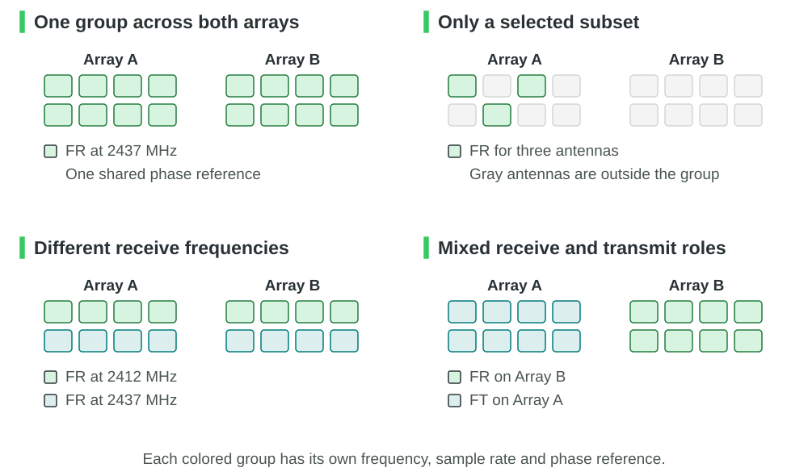
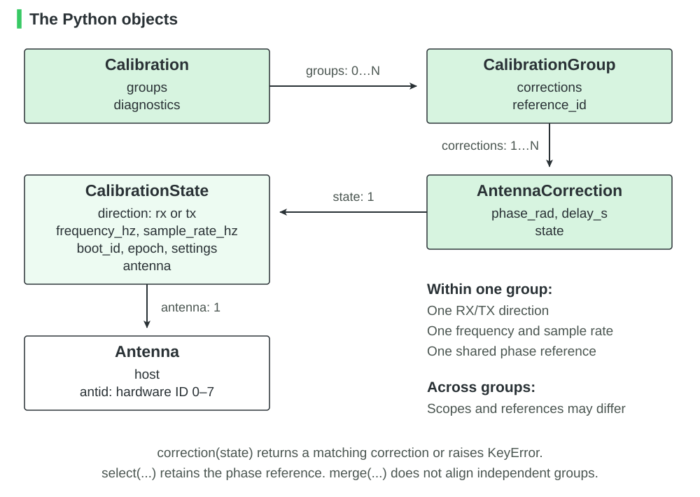
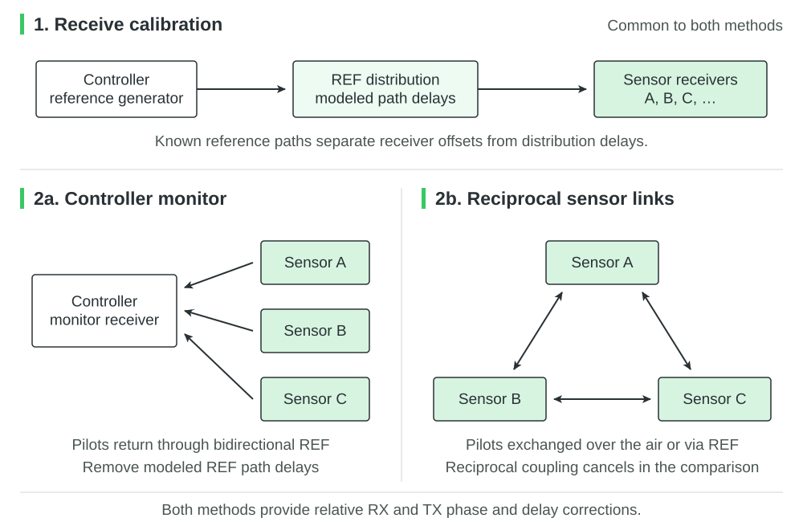
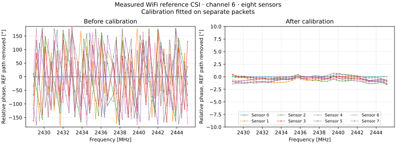

Calibration
===========

A shared clock keeps ESPARGOS sensors in step, but their radio chains still
add different phases and delays. Calibration measures these differences.
We distinguish four kinds of offset:

.. list-table::
   :header-rows: 1
   :widths: 12 32 56

   * - Offset
     - Meaning
     - Effect
   * - CFO
     - Carrier frequency offset
     - The relative carrier phase drifts over time.
   * - SFO
     - Sampling frequency offset
     - The sample grids drift apart over time.
   * - STO
     - Sampling time offset
     - The sample grids start at different times.
   * - CPO
     - Carrier phase offset
     - The carriers have different phases even at the same frequency.

A shared clock removes relative CFO and SFO between sensors at the same
carrier frequency and sample rate, including across connected arrays.
An external transmitter can still have a frequency offset.

STO and CPO remain. Two receivers can report different phases for the same
signal, and identical samples can leave two transmitters at different times.
We calibrate these differences to estimate directions and form transmit beams,
using WiFi reference packets or broadband IQ pilots.

Phase, delay and amplitude
--------------------------

We choose one antenna as the reference. For the same input, we model another
antenna's complex baseband signal as

.. math::

   y(t) = g\,e^{j\phi} x(t-\tau),

where :math:`g > 0` is the relative gain, :math:`\phi` is the carrier phase
offset (CPO), and :math:`\tau` is the relative delay, including the sampling
time offset (STO).
Positive :math:`\tau` means that the signal arrives later.

   Phase rotation and delay for :math:`g=1`, :math:`\phi=45^\circ` and
   :math:`\tau=10\,\mathrm{ns}`. Correcting the phase removes the constant
   offset. Correcting the delay also removes the slope across frequency.

Using :math:`X(f)=\int x(t)e^{-j2\pi ft}\,dt`, we obtain the relative response

.. math::

   H(f) = \frac{Y(f)}{X(f)}
        = g\,e^{j(\phi-2\pi f\tau)},
   \qquad
   \angle H(f) = \phi-2\pi f\tau \pmod{2\pi}.

Here :math:`f` is the **frequency offset from the carrier**.
The phase intercept at :math:`f=0` gives :math:`\phi`, and the slope is
:math:`-2\pi\tau`. In the example, correcting only the 45° offset leaves
an error of −72° at :math:`f=20\,\mathrm{MHz}`.

We correct both terms by multiplying by

.. math::

   C(f) = e^{-j\phi} e^{+j2\pi f\tau},
   \qquad C(f)Y(f) = gX(f).

The gain :math:`g` remains: ESPARGOS corrects relative phase and delay, but
does not equalize receiver gains, transmit power or antenna patterns.

The calibration types
---------------------

The paper `Phase Calibration of Distributed Antenna Arrays
<https://arxiv.org/html/2304.05144v1>`_ by Larsson and Vieira (2023) is a good
first overview of array calibration. We use their terminology from Sections II
and III to distinguish the following calibration types:

.. list-table::
   :header-rows: 1
   :widths: 12 46 42

   * - Type
     - What is known
     - What it enables
   * - FR
     - Relative receive-chain phases
     - Receive beamforming and angle estimation using array geometry
   * - FT
     - Relative transmit-chain phases
     - Transmit beams in a chosen physical direction
   * - R
     - Relative TX/RX relationships between antennas
     - Derive transmit weights from a received pilot using reciprocity
   * - F
     - FR and FT, plus the TX–RX phase relationship within each antenna
     - A common phase reference for reception and transmission

   An arrow means that the starting calibration also provides the information
   of the type it points to, for the same antennas and operating configuration.
   The reverse does not generally hold.

Which antennas does a calibration cover?
----------------------------------------

A :class:`Pool <espargos.pool.Pool>` manages one or more boards. It can hold
several calibration groups, such as receivers on different WiFi channels or
separate IQ RX and TX groups.

   Each color marks one group within an example. Matching colors across the
   two arrays mean that those antennas were calibrated together. Gray antennas
   are not covered. The examples are independent of one another.

A :class:`Calibration <espargos.calibration.Calibration>` contains one or more
:class:`CalibrationGroup <espargos.calibration.CalibrationGroup>` objects.
Each group shares a phase reference, RX/TX role, frequency and
sample rate. Any subset of a group keeps its reference.

To use several boards as one coherent array, calibrate them together against
a common reference. Storing independent measurements in the same object does
not align them.

   The Python objects store per-antenna RX or TX phase and delay corrections,
   together with the state for which each correction is valid.

An :class:`Antenna <espargos.calibration.Antenna>` identifies a controller address and a hardware antenna ID, 0–7.
These IDs are not row/column indices. Use the board revision's mapping when
indexing array-shaped CSI or IQ data.

Choose what to calibrate
------------------------

:meth:`pool.calibrate() <espargos.pool.Pool.calibrate>` calibrates the configured
roles: reception for WiFi and IQ RX sensors, transmission for IQ TX sensors.
Use :meth:`pool.select(...).calibrate() <espargos.pool.AntennaSelection.calibrate>`
for a selection. Both return a :class:`Calibration <espargos.calibration.Calibration>`
and save it in :attr:`pool.calibrations <espargos.pool.Pool.calibrations>`.
Selecting sensors alone changes no settings.

**Recalibrate whole groups.** After measuring ``[0, 1, 2]`` as one group:

.. list-table::
   :header-rows: 1
   :widths: 48 52

   * - Operation
     - Result
   * - Use ``[0, 1]`` without recalibrating
     - Allowed. The subset keeps the group's reference.
   * - Recalibrate ``[0, 1, 2]``
     - Replaces the group.
   * - Calibrate ``[0, 1, 2, 3]``
     - Replaces it with a larger group.
   * - Calibrate ``[1, 2]`` or ``[1, 2, 3]``
     - Rejected before hardware changes. Include sensor ``0`` too.
   * - Calibrate a separate set, such as ``[4, 5]``
     - Creates an independent group.

The rule applies separately to RX and TX at each frequency. To combine
independent groups coherently, calibrate their union together.

WiFi calibration can visit several channels in one call. Selected IQ sensors
need one center frequency and RX sample rate. TX sensors also need prepared
waveforms of equal replay length. Reciprocity requires at least two selected
transmitters.

IQ calibration changes modes and tuning only within the selection. Shared
reference and capture controls briefly interrupt normal reception and pause
transmission on participating boards. These settings are restored afterward.

.. note::

   IQ subgroups sharing a board need an existing synchronized sample grid at
   80 MSa/s. Establish it by calibrating all participating IQ sensors once.
   That measurement also creates a group, which must be recalibrated in full
   while it is retained. Closing and reopening a pool keeps the hardware grid
   but starts without stored Python calibration. Creating a new grid during
   subgroup calibration is rejected because it would restart other sensors.

How to measure calibration
--------------------------

Receive calibration
~~~~~~~~~~~~~~~~~~~

The controller sends a reference through the REF distribution network.
We measure it at the sensors and subtract the modeled cable and distribution
delays to obtain **FR calibration**. WiFi uses reference packets, IQ uses a
broadband signal.

Combined arrays need a shared clock, a common RF reference and the correct
cable lengths. See :doc:`combined-arrays` for wiring and configuration.

Transmit calibration
~~~~~~~~~~~~~~~~~~~~

We can measure the transmit offsets in two ways. In both cases, we start with
receive calibration.

   Arrows show calibration signals. The shared clock and control connections
   are omitted.

**Controller monitor.** Sensors transmit pilots back through REF to the
controller's receiver. Its response is common to all measurements. Subtracting
the modeled REF delays gives the relative TX phase and delay. This needs a
bidirectional RF path.

.. warning::

   Aperture kits use a unidirectional amplifier-splitter in the REF network,
   so we cannot use controller-monitor TX calibration with these kits. Use
   reciprocal sensor calibration instead.

**Reciprocal sensor links.** Sensors exchange pilots in both directions,
either over the air or through coupling between REF ports. Comparing the two
directions cancels the coupling, provided it is reciprocal and stable during
the measurement. After removing the measured RX response, we obtain the
relative TX response. The selected sensors need enough usable links to connect
them. The procedure tries additional reference sensors if needed and validates
the result with fresh captures.

Both methods start with forward REF receive calibration and provide **FR + FT**.
IQ synchronization also puts TX and RX on a common sample grid, but the common
carrier-phase offset between TX and RX remains unknown. This is not full
**F calibration**, though it is enough for receive processing and geometric
transmit steering.

Accuracy depends on the reference-path model. A wrong cable delay becomes a
calibration error, and differences between the REF and antenna routes can
leave residual offsets.

WiFi: measure and apply a calibration
-------------------------------------

Enable transmit authorization for the reference generator first. This example
uses the board's internal reference.

For WiFi, :meth:`pool.calibrate() <espargos.pool.Pool.calibrate>` measures each
configured channel without retuning the sensors. ``duration`` is the capture
time per channel. When all sensors use one channel, the same measurement also
updates the array-shaped CSI calibration used by backlogs and WiFi transmit
schedules. Timestamp association is available when the sensors share one
clock reference. Subset or multi-channel measurements retain separate groups.

.. code-block:: python

   from espargos import Pool

   with Pool("172.16.0.241") as pool:
       pool.configure(mode="wifi", channel=6, secondary_channel=0)
       pool.select(antennas=[0, 1, 2, 3]).configure(channel=1)
       receiver = pool.wifi
       receiver.set_csi_acquisition_config({"acquire_csi_force_lltf": True})
       result = pool.calibrate(duration=2)
       states = receiver.get_calibration_states()

       def receive(cluster):
           calibrated = receiver.apply_calibration(
               cluster, "lltf", calibration=result, states=states,
           )
           # Shape: (boards, rows, columns, subcarriers).
           # Missing or unselected antennas contain NaN.
           print(calibrated.shape)

       receiver.add_callback(
           receive,
           callback_predicate=lambda c: c.has_lltf and c.completion.sum() == 4,
       )
       for _ in range(100):
           pool.run(timeout=0.05)

Passing ``states`` avoids HTTP reads inside the callback. Refresh them after
configuration changes or reconnects. If omitted,
:meth:`apply_calibration() <espargos.wifi_transceiver.WiFiTransceiver.apply_calibration>`
reads the current state itself. Missing or stale corrections raise ``KeyError``.
The result includes the usual CSI timestamp and gain-phase corrections.

We can use a subset of an existing measurement without recalibrating::

   from espargos.calibration import Antenna

   subset = result.select(antennas=[Antenna("172.16.0.241", a) for a in [0, 2]])

WiFi uses a separate reference for each board by default. For a combined
array sharing a reference, pass ``per_board=False``. A layout loaded with
:meth:`Pool.from_config() <espargos.pool.Pool.from_config>` supplies cable
corrections, but does not choose this setting for you:

.. code-block:: python

   from espargos import Pool

   with Pool.from_config("config/aperture-kit-8x4.yml") as pool:
       pool.configure(mode="wifi", channel=6, secondary_channel=0)
       result = pool.calibrate(per_board=False)

Both 20 MHz and bonded 40 MHz WiFi channels are supported.

   We check the calibration with a separate reference capture on one eight-sensor
   array, channel 6. We plot phase relative to sensor 0 at each frequency and
   account for the modeled REF distribution delays. After correction, the
   phase differences should approach zero.

IQ: measure and apply a calibration
-----------------------------------

For IQ reception, :meth:`pool.calibrate() <espargos.pool.Pool.calibrate>`
synchronizes the sample grids and measures phase and delay with the broadband
REF source. It chooses the reference receive gain automatically.

RX corrections are applied in software. This example uses the array-shaped
model from the latest measurement:

.. code-block:: python

   import numpy as np
   from espargos import Pool

   with Pool("192.168.1.2") as pool:
       pool.configure(mode="iq_rx", frequency_hz=2437e6,
                      sample_rate_hz=80e6, output="antenna_r")
       receiver = pool.iq
       result = pool.calibrate()

       def receive(cluster):
           if not receiver.calibration_applies_to(cluster):
               raise RuntimeError("IQ capture does not match the calibration")
           spectrum = np.fft.fftshift(np.fft.fft(cluster.iq, axis=-1), axes=-1)
           spectrum *= receiver.cal_correction(fft_size=cluster.iq.shape[-1])
           print(spectrum.shape)

       receiver.add_callback(receive)
       for _ in range(100):
           pool.run(timeout=0.05)

:attr:`pool.iq.calibration <espargos.iq_receiver.IQReceiver.calibration>` holds
the latest receive model, with NaN outside its selection.
:meth:`cal_correction() <espargos.iq_receiver.IQReceiver.cal_correction>` evaluates
it on an FFT grid. For stored groups or a different sensor order, use
:meth:`Calibration.response() <espargos.calibration.Calibration.response>` instead.

The lower-level :meth:`receiver.sync() <espargos.iq_receiver.IQReceiver.sync>`
returns a :class:`SensorCalibration <espargos.sensor_calibration.SensorCalibration>`.
Prefer the pool API for selections and mixed RX/TX roles.

IQ tuning supports 2310–2640 MHz. Synchronization still needs a usable reference
signal at the chosen frequency. Python does not import calibration from the
web interface. See :doc:`iq-reception` for capture and trigger setup.

For IQ transmission, we first configure sensor modes and source waveforms.
The pool uses reciprocity by default, but we can select either method::

   result = pool.calibrate(tx_method="monitor")
   # Or exchange pilots between sensors:
   result = pool.calibrate(tx_method="reciprocity", path="reference")

With reciprocity, choose ``path="antenna_l"`` or ``"antenna_r"`` for OTA
measurements. TX calibration applies the corrections on the sensors, so do
not apply them again to uploaded waveforms. Each run uses one common TX
frequency and replay length.

See :doc:`iq-transmission` for a complete :class:`Pool <espargos.pool.Pool>` example, waveform
selection and steering for single and combined arrays.

.. _calibration-range-zero:

TX–RX delay and range zero
----------------------------------

RX calibration aligns receivers with one another. TX calibration does the
same for transmitters. Neither determines the remaining hardware delay
between TX and RX. Measuring it separately lets us distinguish hardware delay
from the signal's travel time along the measured path.
:meth:`pool.calibrate_tx_rx_delay() <espargos.pool.Pool.calibrate_tx_rx_delay>` sends its own probes through
the selected path, then restores the application waveforms and settings.
The default is the reference network. Antenna paths are also supported.

.. code-block:: python

   pool.calibrate(tx_method="monitor")       # or "reciprocity"
   timing = pool.calibrate_tx_rx_delay()

   hardware_delay_s = timing.delays_s[transmitter]
   propagation_delay_s = measured_delay_s - hardware_delay_s

Use one RX calibration group and one TX calibration group at the same
frequency, with prepared TX buffers and valid calibration. Sensors within
each group share a phase reference. Timing probes temporarily use 80 MSa/s
reception, then restore the selected RX rate and application waveforms.
The TX replay length stays unchanged. For buffers longer than 1024 samples,
the probe repeats every 1024 samples. The reference path must be shorter than
this probe period to avoid ambiguous delays. Changing the TX replay length
invalidates the old calibration.
``transmitter`` is an :class:`Antenna <espargos.calibration.Antenna>` from the TX selection.

Use :meth:`pool.select(antennas=...).calibrate_tx_rx_delay() <espargos.pool.AntennaSelection.calibrate_tx_rx_delay>` to measure a subset,
including both TX and RX sensors. Below 80 MSa/s, include all active RX sensors
on each affected board because the RX rate is shared. Independent groups need
separate timing records.

The reference path must provide coupling between sensor ports. We subtract
the modeled delays of board traces and configured cables. Any splitter or
cable delay missing from that model remains a range error.

For an antenna path, supply its propagation delay explicitly::

   timing = pool.calibrate_tx_rx_delay(
       path="antenna_r",
       reference_delays_s={(tx, rx): path_delay_s for tx in tx_antennas
                           for rx in rx_antennas},
   )

Supply the known propagation delay for each TX/RX pair, such as distance
divided by propagation speed. Ensure the direct path dominates reflections.

We can also remove the hardware delay directly from a channel spectrum::

   channel *= timing.response(transmitter, frequencies_hz)

``frequencies_hz`` contains absolute RF frequencies, as for RX corrections.
Apply the RX correction first. The sensor already applies its TX correction.
The timing correction then places the delay origin at the antenna feeds.
It corrects delay, but does not measure the remaining common carrier-phase
offset between TX and RX.

If a separate instrument or application has measured a known path, use
:meth:`TxRxDelayCalibration.from_reference(calibration, measured_delay_s=..., reference_delay_s=...) <espargos.iq_tx_rx_delay.TxRxDelayCalibration.from_reference>` to store its result. Select one coherent RX group
and TX group from :attr:`pool.calibrations <espargos.pool.Pool.calibrations>`. Independent groups or different
frequencies need separate timing records.

Reusing TX–RX delay calibration after mode changes
~~~~~~~~~~~~~~~~~~~~~~~~~~~~~~~~~~~~~~~~~~~~~~~~~~~~

:attr:`pool.calibrations <espargos.pool.Pool.calibrations>` retains RX and TX corrections independently. At a fixed
frequency, IQ RX/TX switches preserve RF phase but restart the sample engine.
:meth:`pool.configure() <espargos.pool.Pool.configure>` adjusts the retained corrections to the reported sample
start time automatically. Both directions must have been calibrated beforehand.
Retuning, changing sample rate or TX replay length, entering WiFi, or rebooting
requires recalibration.

For example, after measuring both directions for the selected transmitters::

   transmitters.stop_transmission()
   transmitters.configure(mode="iq_rx")
   # These antennas can now receive using their retained RX corrections.
   transmitters.configure(mode="iq_tx")
   calibration = pool.calibrations
   timing = timing.for_calibration(calibration)
   transmitters.start_transmission()

:meth:`timing.for_calibration() <espargos.iq_tx_rx_delay.TxRxDelayCalibration.for_calibration>` checks that the original measurement groups still
cover these sensors. Use the updated RX corrections for subsequent captures.
The sensors already apply the updated TX corrections.

:meth:`pool.refresh_calibration() <espargos.pool.Pool.refresh_calibration>` explicitly checks when each sensor started sampling or playing its waveform, briefly
changing and restoring the capture trigger. Call it outside capture callbacks.
The pool must be the sole configuration owner. After changes through another
application or direct board API calls, recalibrate. Mode changes are blocking
control operations and do not provide sample-timed TX/RX switching.

Validity and reuse
------------------

Calibration belongs to a particular radio configuration. Use
:meth:`pool.configure() <espargos.pool.Pool.configure>` so the pool can track
changes.

.. list-table::
   :header-rows: 1
   :widths: 45 55

   * - Change
     - Can I keep the calibration?
   * - Use fewer antennas from a measured group
     - Yes.
   * - Switch IQ RX/TX at the same frequency through the pool
     - Yes, if that sensor already has calibration for the new role (RX or TX). The pool updates the timing correction automatically.
   * - Change frequency, IQ sample rate or the number of samples in the repeating TX waveform
     - No. Recalibrate the group you want to use together.
   * - Switch between WiFi and IQ, or reboot
     - No. Recalibrate.
   * - Return to an earlier frequency
     - No. The earlier RF phase is not restored.

Switching between IQ RX and TX restarts sample capture or waveform playback.
The first sample may then occur at a different time. The pool reads that start
time and adjusts the stored delay correction, without measuring the radio
chain again. :meth:`pool.refresh_calibration() <espargos.pool.Pool.refresh_calibration>`
performs this check explicitly. It cannot create a TX correction from RX
calibration, or the reverse. See :ref:`calibration-range-zero` for keeping the same zero point
on a radar's range axis.

A :class:`CalibrationState <espargos.calibration.CalibrationState>` is a snapshot
of a sensor's settings. It also identifies the device restart and capture or
playback session, so an old correction does not accidentally match a new
session with the same frequency and sample rate.

Refresh these snapshots after configuration changes or reconnects. They do
not update themselves, and reading the current frequency cannot reveal a
retune away and back. After changing
tuning or modes outside the pool, recalibrate. For WiFi, first call
:meth:`invalidate_calibration() <espargos.wifi_transceiver.WiFiTransceiver.invalidate_calibration>`.
WiFi states belong to the pool that created them.

Use stored corrections
----------------------

:meth:`result.select() <espargos.calibration.Calibration.select>` extracts a
subset. :meth:`older.merge(newer) <espargos.calibration.Calibration.merge>`
combines results or replaces complete groups. Partial replacements raise
``ValueError``. Neither operation aligns independent references.

For custom processing,
:meth:`result.response(states, frequencies_hz) <espargos.calibration.Calibration.response>`
returns one row per supplied state and one column per **absolute RF frequency
in Hz**. Missing or stale corrections raise ``KeyError``. Mixing independent
references for the same RX/TX role raises ``ValueError``. Process those groups
separately or calibrate them together. This method does not read the hardware.

For one antenna, use
:meth:`result.correction(state) <espargos.calibration.Calibration.correction>`
and its :meth:`response() <espargos.calibration.AntennaCorrection.response>`.
Apply RX corrections once. TX calibration is already applied on the sensors.
:attr:`result.diagnostics <espargos.calibration.Calibration.diagnostics>` holds
the measurement method and available fit results.
