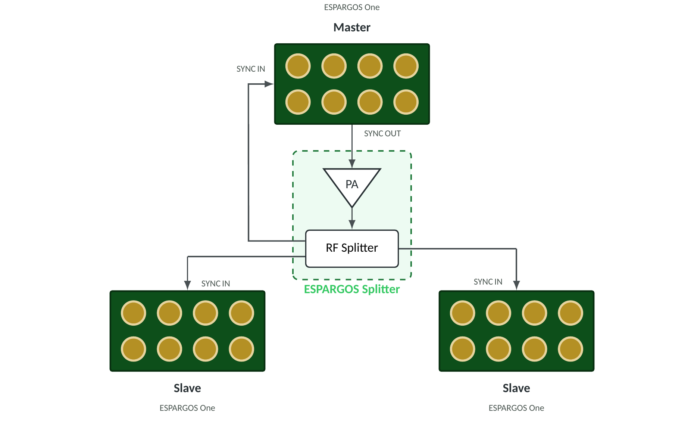
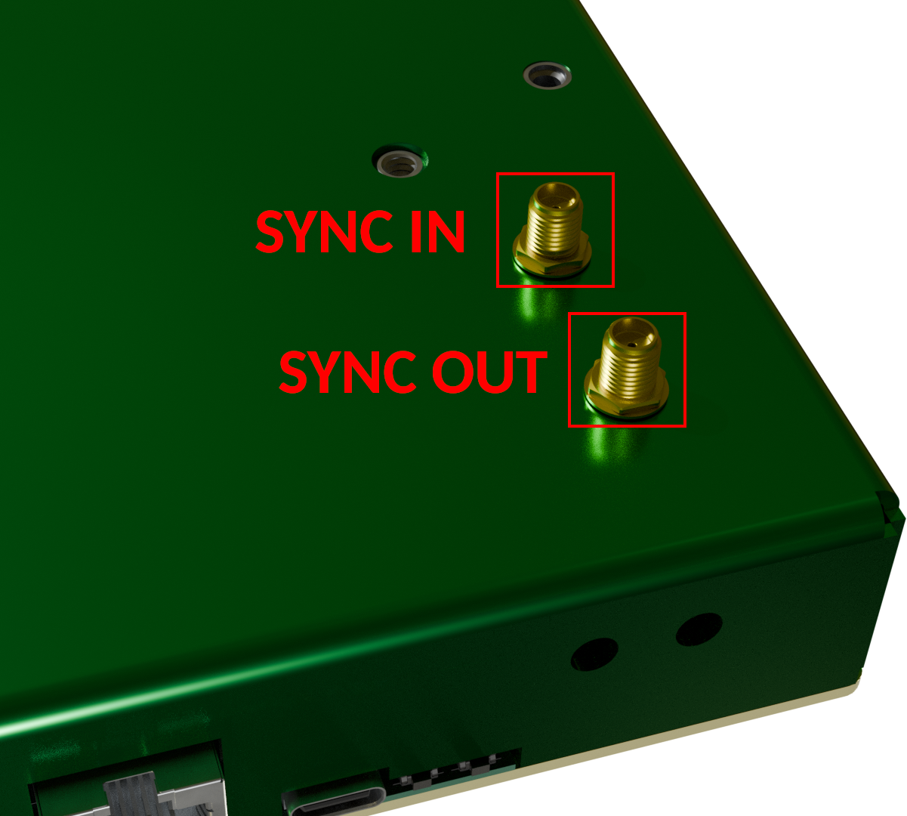
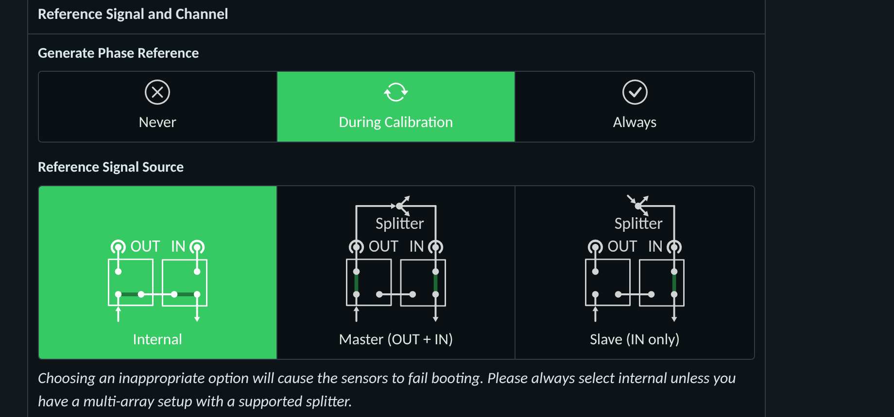

Phase-Coherent Multi-Array Systems
==================================

By default, each ESPARGOS device with its 2 × 4 antennas is phase-coherent only *within itself*: the eight antennas of one array share a common reference, but separate arrays each use their own internal reference and are therefore *not* mutually phase-coherent.
We can operate multiple ESPARGOS devices coherently by sharing a clock and
calibrating their relative phase and timing offsets. This applies to WiFi
reception, raw IQ reception and IQ transmission.
This is an advanced feature intended for research use only.

A phase-coherent system built from several ESPARGOS devices can be arranged in two ways:

* **One large-aperture array** — the devices are mounted close together to synthesize a single, larger antenna array with finer angular resolution than an individual device.
* **Multiple distributed arrays** — the devices are spread across the environment to observe it from several vantage points, while still being mutually phase-coherent.

In both cases the wiring and configuration are identical; what differs is only the physical placement of the devices.
This page describes how to wire and configure the devices for phase-coherent operation.
If you don't need phase-coherence *across* devices, there is no need to follow these instructions: individual, unsynchronized ESPARGOS arrays are the normal configuration.

.. note::
   Several independent, unsynchronized arrays are sufficient for many applications.
   Angle-of-arrival (AoA) localization relies only on the phase coherence *within* a single device and needs no synchronization between devices.
   Comparing arrival times across devices, combining their received signals
   coherently, or steering a transmit beam across boards requires a shared
   timing reference and the appropriate calibration.

   Distributed star-topology setup: the master's SYNC OUT drives a power amplifier (PA) whose output feeds an RF power splitter. One splitter port returns to the master's own SYNC IN; the rest feed the slaves. For clarity, only the synchronization (SYNC) cabling is shown; the Ethernet cabling is omitted. For up to four devices, the PA and splitter can be combined into a single *ESPARGOS Splitter* unit (dashed box).

Hardware Setup
--------------
Every ESPARGOS array integrates a reference signal generator that produces the frequency-multiplexed 40 MHz clock and 2.4 GHz phase synchronization signals.
By default, each array uses its own internal reference, so only the eight antennas *within* that array are phase-synchronous, and separate boards are not mutually phase-coherent.

To make multiple ESPARGOS devices phase-coherent with each other, all devices must share the same reference signal.
Arbitrarily select one of the arrays as the **master**: it generates the shared reference for the whole system.
All other arrays act as **slaves** that lock onto this reference.
The reference signal is distributed via the **SYNC OUT** and **SYNC IN** SMA ports on the side panel of each device.

   The two SMA reference-signal ports, **SYNC IN** and **SYNC OUT**, on the side panel of each ESPARGOS device.

Wire the devices in a **star topology** (see schematic above):

* The **master** generates the shared reference (40 MHz clock + 2.4 GHz phase, with DC bias) and outputs it on its **SYNC OUT** port.
  Crucially, the master must also receive the reference back on its own **SYNC IN** port, so that it locks onto the same distributed signal as its slaves.
* Each **slave** receives the reference on its **SYNC IN** port only.
* Because the master must also receive the reference back, the SYNC OUT signal is **always** routed through an RF power splitter, with one output port per node, *including the master itself*.
* **All cables from the splitter outputs to the devices must be identical in length and type.**
  Any difference in electrical length introduces a fixed phase offset between the devices.
  (Alternatively, describe known cable lengths in the array configuration
  so calibration can account for them.)

Choosing a splitter and amplifier
^^^^^^^^^^^^^^^^^^^^^^^^^^^^^^^^^^
The RF power splitter must be sufficiently wideband to pass both the 40 MHz clock signal and the 2.4 GHz phase reference signal cleanly, without significant attenuation, distortion, or phase imbalance between its output ports.

* **For two arrays (one master and one slave):** a simple, low-cost resistive RF splitter is sufficient.
  No power amplifier is needed; the master's SYNC OUT provides enough signal amplitude for the calibration signal.
* **For more than two arrays:** insert a **wide-band RF power amplifier** between the master's SYNC OUT and the splitter to offset the splitter's insertion loss.
  Both the amplifier and the splitter must operate across the full required range, i.e., they must amplify and split both the 40 MHz clock signal and the 2.4 GHz phase reference signal.
  A **resistive splitter** is recommended, as resistive splitters are inherently wideband.

In any case, make sure that the signal power at the SYNC IN of each ESPARGOS device is sufficient for stable operation.
The power of the clock signal is the most critical; the phase reference signal is less critical.

.. note::
   For up to four devices (one master and up to three slaves), an *ESPARGOS Splitter* — a single unit combining the power amplifier and the RF power splitter — is available from the manufacturer upon request.

.. note::
   If your phase measurements appear noisy or unstable, this may be caused by the amplitude of the clock signal being too low.
   Make sure to choose a suitable power amplifier to boost the clock signal to the desired level.
   A voltage level of 1 Vpp at the SYNC IN of each ESPARGOS is definitely sufficient.
   Make sure not to exceed 3.3 Vpp.

.. warning::
   A device configured as master actively drives **SYNC OUT** with strong 40 MHz and 2.4 GHz signals.
   An open, unterminated, or poorly shielded SYNC OUT can radiate the 2.4 GHz signal like an antenna, which may interfere with other equipment or violate local regulations.
   Never run a master with SYNC OUT left open: always route it through shielded SMA cabling into a splitter, or terminate the port.

Software Setup
----------------

The reference role describes the wiring. It is independent of whether the
sensors use WiFi, IQ RX or IQ TX. In the web interface's **Settings**, select
**Reference Signal Source** for each board:

* **Internal**: a standalone array uses its own clock and reference generator.
* **Master (OUT + IN)**: the board generates the shared reference and receives
  it back through the splitter on SYNC IN.
* **Slave (IN only)**: the board receives the master's reference on SYNC IN.

   Reference-source selection and the WiFi phase-reference policy.

.. warning::

   The reference role must match the wiring. A slave without a clock on
   SYNC IN cannot boot its sensors. Leave standalone boards on **Internal**.

For WiFi calibration, set **Generate Phase Reference** to **During
calibration** on the master and **Never** on slaves. This setting controls
WiFi reference packets, not the shared 40 MHz clock. IQ calibration uses
custom IQ reference signals instead. The Python calibration routines select
the required controller radio function and coordinate acquisition across
boards.

.. note::

   Selecting the reference input on a slave does not make the master generate
   a calibration signal. Calibrate the connected boards together through one
   ``Pool`` so the library controls both the source and the receivers.

Configure a combined pool
---------------------------

An array configuration records board addresses, antenna positions and the
reference cables from splitter outputs to boards. For example, the supplied
aperture-kit configuration describes four boards arranged as an 8 × 4 array::

   from espargos import Pool

   pool = Pool.from_config("config/aperture-kit-8x4.yml")

Each board's ``cable.length`` is in metres. ``cable.velocity_factor`` gives
propagation speed relative to the speed of light. Calibration uses these
values to account for different cable delays. Use the cable manufacturer's
velocity factor and the measured cable length. Equal cables contribute a
common delay, so their length differences are zero.

The configuration describes geometry and cabling. It does not select sensor
modes or establish the physical clock connection. See :doc:`pool` for choosing
sensor subsets and assigning different roles.

Calibrate for the chosen sensor modes
---------------------------------------

``pool.calibrate()`` measures the corrections needed for the sensors' current
roles. For WiFi reception across a shared reference network, use
``per_board=False`` to relate receivers across boards::

   with Pool.from_config("config/aperture-kit-8x4.yml") as pool:
       pool.configure(mode="wifi", channel=6)
       calibration = pool.calibrate(per_board=False)

For IQ reception, we configure the sample rate and frequency before calibration::

   with Pool.from_config("config/aperture-kit-8x4.yml") as pool:
       pool.configure(mode="iq_rx", frequency_hz=2437e6,
                      sample_rate_hz=80e6)
       calibration = pool.calibrate()

These examples obtain calibration results. :doc:`wifi-reception` and
:doc:`iq-reception` show how to acquire measurements, and :doc:`calibration`
explains how to apply corrections and combine calibration groups.

IQ transmit calibration
-------------------------

For IQ TX, prepare the signals before calling ``pool.calibrate()``. There are
two methods:

* ``tx_method="monitor"``: sensors transmit into REF and the controller
  receives them. This requires a bidirectional RF path through the reference
  network.
* ``tx_method="reciprocity"``: sensors receive the controller reference and
  exchange pilots with each other. The controller-to-sensor path may be
  unidirectional. Sensor-to-sensor coupling must still be sufficient for the
  selected antennas to be calibrated together.

.. warning::

   Aperture kits with an amplifying reference splitter cannot use the
   controller-monitor method through that splitter. Use reciprocity with
   ``path="reference"``, or an antenna feed if the reference network does not
   provide sufficient coupling between sensors.

Use the Python library for combined-array TX calibration. The web interface
supports TX calibration on standalone arrays only. See :doc:`iq-transmission`
for waveform preparation and beam steering, and :doc:`calibration` for the
signal paths used by each method.
