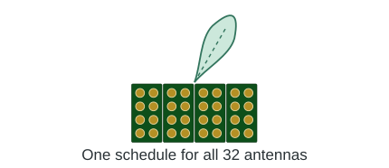
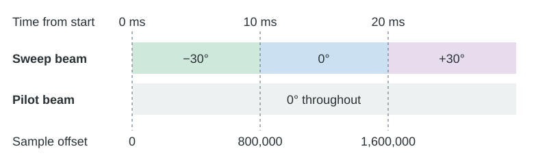
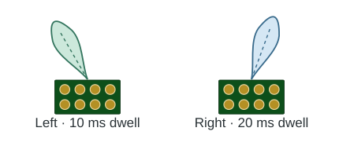
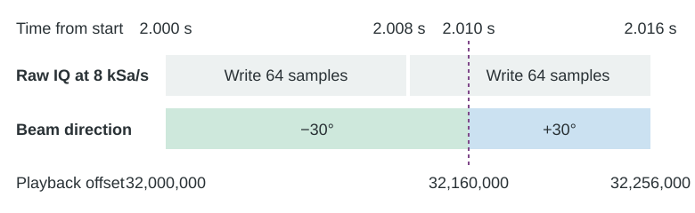
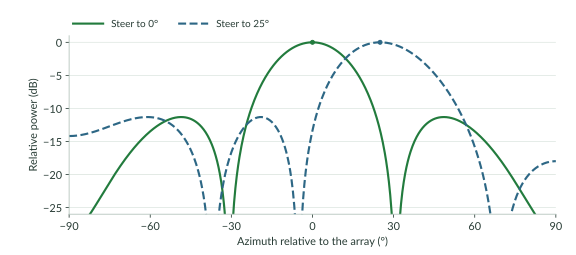

Scheduled IQ Beam Steering
==========================

.. warning::

   IQ transmit streaming is experimental and under development.
   The associated demos are unstable, and the API will change without notice.

Suppose a receiver records a tone while the array scans a room. To match
each part of the recording to a direction, you need to know when the beam
turned. If a Python loop sets ``beam.steering`` every 10 ms, the timing also
depends on when the host wakes up and when each controller receives its update.

With ``tx.schedule_steering()``, you send the directions ahead of time. Each
sensor applies its phase changes against the transmit sample clock, while the
waveform keeps playing. Use :doc:`iq-transmission` for occasional direction
changes and :doc:`iq-transmit-streaming` to send new waveform samples.

For a looped beam you can set a fractional delay for each antenna, for example
``beam.delay_samples = {beam.antennas[0]: 0.5}``. This shifts that antenna's
waveform by half a playback sample. Each scheduled turn applies its complex
weight to the same delayed waveform. Assigning new delays through the SDK
closes the current schedule. Start a new schedule to continue the sweep.

A steering schedule works with either source.

Run the examples from the SDK checkout with transmit authorization enabled.
Replace the example addresses or layout file with those for your hardware.
Angles are in degrees from broadside, the direction straight out from the array.

.. _iq-loop-steering-clock:

One combined array
------------------

When several boards form one aperture, a beam spans all their antennas.
Load the geometry of the assembled array and calibrate the boards together
on a shared clock and reference. A single schedule then sets the direction
for the whole aperture. See :doc:`combined-arrays` for the wiring.

   One signal uses all four boards. Its direction is measured from the face of the assembled array.

This example sweeps a tone across an 8 × 4 aperture kit. A second tone stays
at broadside as a pilot. Only the moving signal appears in the schedule.

.. code-block:: python

   from espargos import Pool
   from espargos.steering import Beamspace
   from espargos.waveforms import CW

   rate = 80_000_000
   with Pool.from_config("config/aperture-kit-8x4.yml") as pool:
       pool.configure(mode="iq_tx", frequency_hz=2440e6, sample_rate_hz=rate,
                      output="antenna_r", rf_gain={"a": 0, "b": 0})
       tx = pool.tx
       with tx.update(samples=1024):
           beam = tx.signals.add(waveform=CW(offset_hz=1.25e6), amplitude=0.05)
           tx.signals.add(waveform=CW(offset_hz=-1.25e6), amplitude=0.05)
       pool.calibrate(tx_method="reciprocity", path="antenna_r")

       changes = [(i * (rate // 100), beam, Beamspace(azimuth_deg=angle))
                  for i, angle in enumerate((-30, 0, 30))]
       pool.start_transmission()
       with tx.schedule_steering(changes) as sweep:
           sweep.wait()
       pool.stop_transmission()

   At 80 MSa/s, 800,000 playback samples separate the turns by 10 ms.

Each tuple specifies a playback sample offset, a signal and its new steering.
Offset zero refers to ``sweep.start_sample``. The SDK chooses a future sample
on the calibrated playback clock and sends
each turn ahead of its deadline. To set the first sample yourself, pass
``start_sample``. Give both beams the same offset to turn them together.

Each sensor can hold 256 future turns. For longer schedules the SDK waits
for free slots as it sends. ``wait()`` checks that every selected sensor
applied all its turns and reports missing updates or missed deadlines.
If a turn arrives late or its UDP datagram is lost, that sensor keeps its
previous direction until the next accepted turn. Leaving the schedule early
cancels future turns. On a live stream, samples already prepared for the
radio play out before cancellation takes effect. You can then schedule a
new sweep on the same antennas.

Per-antenna weights
-------------------

If you already know the complex coefficient for each antenna, pass
:class:`~espargos.steering.Weights` as the third item in a schedule entry.
This works for both a repeating signal and a live stream. Each entry gives
the complete set of weights for that signal. Selected antennas omitted from
the mapping use ``1``, so ``Weights({})`` restores uniform weighting. Use
``0`` to silence one antenna's contribution to that signal.

This example plays a tone on all eight antennas. After 10 ms, antenna 0
goes silent and antenna 1 transmits at half amplitude with a +90° phase
shift. After another 10 ms, both return to their original weights::

   from espargos import Pool
   from espargos.steering import Weights
   from espargos.waveforms import CW

   rate = 80_000_000
   with Pool("192.168.1.2") as pool:
       pool.configure(mode="iq_tx", frequency_hz=2440e6, sample_rate_hz=rate,
                      output="antenna_r", rf_gain={"a": 0, "b": 0})
       tx = pool.tx
       with tx.update(samples=1024):
           tone = tx.signals.add(waveform=CW(offset_hz=1.25e6), amplitude=0.05)
       pool.calibrate(tx_method="reciprocity", path="antenna_r")

       a0, a1 = pool.select(antennas=[0, 1]).antennas
       dwell = rate // 100
       changes = [(dwell, tone, Weights({a0: 0, a1: 0.5j})),
                  (2 * dwell, tone, Weights({}))]
       pool.start_transmission()
       try:
           with tx.schedule_steering(changes) as sweep:
               sweep.wait()
       finally:
           pool.stop_transmission()

Offsets are relative to the schedule start. Each coefficient multiplies the
signal's amplitude. The same antenna IDs occur on different boards, so the
mapping keys include both the board address and the sensor ID. To change a
live stream, pass the stream handle in place of ``tone`` and use the playback
sample grid described below.

Two independent arrays
----------------------

One pool can steer two beams independently. In this example, two horizontal
boards sit side by side and share a clock and calibration reference. Each
transmits its own tone on its own eight antennas. The left board scans from
−30° to +30° in 10 ms steps. The right scans the other way in 20 ms steps.

   Each board has its own schedule. The left board can finish its scan while the right board is still turning.

.. code-block:: python

   from espargos import Pool
   from espargos.steering import Beamspace
   from espargos.waveforms import CW

   boards = {"left": {"host": "192.168.1.2"}, "right": {"host": "192.168.1.3"}}
   layout = {"boards": boards,
             "array": [[f"{board}.{row}.{col}" for board in boards for col in range(4)]
                       for row in range(2)]}
   rate = 80_000_000

   def scan(beam, angles, dwell_ms):
       dwell = rate * dwell_ms // 1000
       return [(i * dwell, beam, Beamspace(azimuth_deg=angle))
               for i, angle in enumerate(angles)]

   with Pool.from_config(layout) as pool:
       pool.configure(mode="iq_tx", frequency_hz=2440e6, sample_rate_hz=rate,
                      output="antenna_r", rf_gain={"a": 0, "b": 0})
       tx = pool.tx
       with tx.update(samples=1024):
           left = tx.signals.add(antennas=pool.select(boards="left"),
                                 waveform=CW(offset_hz=1.25e6), amplitude=0.05)
           right = tx.signals.add(antennas=pool.select(boards="right"),
                                  waveform=CW(offset_hz=-1.25e6), amplitude=0.05)
       pool.calibrate(tx_method="reciprocity", path="antenna_r")

       left_changes = scan(left, (-30, 0, 30) * 40, dwell_ms=10)
       right_changes = scan(right, (20, 0, -20) * 40, dwell_ms=20)
       pool.start_transmission()
       try:
           with tx.schedule_steering(left_changes) as left_scan:
               with tx.schedule_steering(right_changes) as right_scan:
                   left_scan.wait()
                   right_scan.wait()
       finally:
           pool.stop_transmission()

Arm both schedules before calling ``wait()``. Each runs on its own sensors
while Python waits for either one. Offsets are measured from each schedule's
``start_sample``. If both scans need the same start sample, pass
``left_changes + right_changes`` to a single ``tx.schedule_steering()`` call.
The two beams still keep their own directions and dwell times.

Steer a live stream
-------------------

A live stream has two rates. In this example, the host supplies 8,000 IQ
samples per second and the sensors play 16 million samples per second. To
turn the beam at a known point in the tone, count from ``stream.start_sample``
on the **playback** clock. Live changes fall on multiples of 32 playback
samples, a 2 µs grid. The first stream start is on that grid.

The program sends three seconds of tone to one board before starting playback.
It turns the beam from −30° to +30° at input sample 16,080, rounding up to
the next steering boundary if necessary. The single-board setup uses monitor
calibration, which requires a bidirectional reference path.

.. code-block:: python

   import numpy as np

   from espargos import Pool
   from espargos.steering import Beamspace
   from espargos.stream_sources import Stream

   input_rate = 8000
   playback_rate = 16_000_000
   tone = 0.5 * np.exp(2j * np.pi * 1000 * np.arange(3 * input_rate) / input_rate)
   layout = "config/single-espargos-one.yml"

   with Pool.from_config(layout, hosts=["192.168.1.2"]) as pool:
       pool.configure(mode="iq_tx", frequency_hz=2440e6, sample_rate_hz=playback_rate,
                      output="antenna_r", rf_gain={"a": 0, "b": 0})
       tx = pool.tx
       beam = tx.signals.add(waveform=Stream(sample_rate_hz=input_rate),
                             amplitude=0.05, steering=Beamspace(azimuth_deg=-30))
       pool.calibrate(tx_method="monitor")

       with beam.open_stream() as stream:
           stream.write(tone)
           pool.start_transmission()
           try:
               origin = stream.start()
               target = origin + 16_080 * (playback_rate // input_rate)
               boundary = ((target + 31) // 32) * 32
               changes = [(0, beam, Beamspace(azimuth_deg=30))]
               with tx.schedule_steering(changes, start_sample=boundary) as sweep:
                   stream.finish()
                   sweep.wait()
                   stream.wait()
           finally:
               pool.stop_transmission()

   The turn falls at the same point in playback if the host splits the tone
   into smaller writes. At 8 kSa/s, each input sample lasts 2,000 playback samples.

   Predicted patterns at 2.44 GHz with all eight antennas enabled and zero elevation.

For a longer transmission, keep feeding the stream while the schedule runs.
If the stream runs dry and restarts, schedule a new sweep for that session.
The 2 µs grid describes timing resolution. Dwell time also depends on the
waveform. In an over-the-air test with 80 queued changes, two antennas
stepped through eight relative phases at 250 µs per turn for streamed Raw IQ
and 500 µs per turn for a looped tone. The looped tone missed a deadline
at 250 µs. For a sustained sweep, allow time to send the next set of turns.

During Raw IQ or low-rate Single Carrier streaming you can include a nonzero
looped signal on the same antennas in the stream's steering schedule. With
fast digital formats such as GFSK, keep those loops fixed. A loop on separate
antennas can follow its own schedule.
