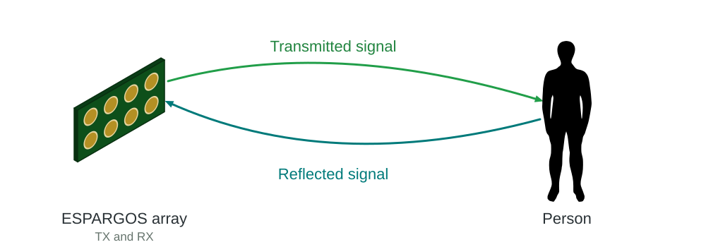
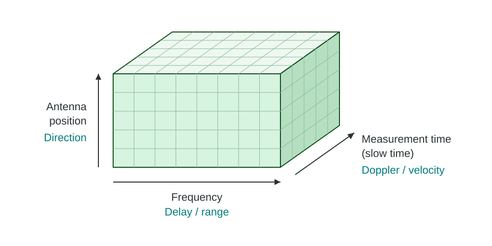
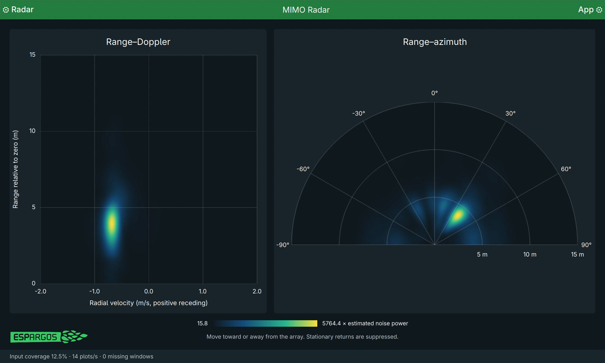

IQ Radar
========

   Monostatic radar uses transmitters and receivers on the same array to detect reflections.

.. warning::

   **Authorization to transmit is required.**

   Enable transmit authorization in the settings of the controller's web interface
   only after
   confirming that you are legally permitted to transmit with the selected
   frequency, bandwidth, power and antenna configuration. IQ transmission is
   experimental and can produce high EIRP. Use this feature at your own risk.

IQ radar combines :doc:`IQ transmission <iq-transmission>` and
:doc:`IQ reception <iq-reception>` in mixed operation: some sensors run in
``iq_tx`` mode while others run in ``iq_rx`` mode. The transmitters send known
waveforms, and the receivers capture their reflections. This uses the same
TX and RX APIs described on those pages, with no separate radar mode.

Each sensor is half-duplex: it can either transmit or receive. Separate sensors
can transmit and receive at the same time, on one board or across several
boards. Combining their measurements requires a shared clock and calibration;
see :doc:`combined-arrays`.

The library provides waveform generation, synchronized capture and calibration.
Your application turns those samples into range, motion and direction estimates.
The same APIs support OFDM signals, LFM chirps and other uploaded IQ waveforms.

.. important::

   **Use the Accumulate trigger mode for repeating radar waveforms.**

   With ``trigger.mode="accumulate"``, each sensor averages matching complex IQ samples
   across repeated waveforms before sending them to Python. Stable reflections
   add together while uncorrelated noise averages down. This makes weak echoes
   easier to detect and reduces network traffic and host processing compared
   with transferring every repetition separately.

   Keep the averaging window short enough to preserve the motion you want to
   measure. Successive averaged captures can then be used for Doppler processing.

   Set the accumulation vector to the waveform's repetition length in received
   samples, or an integer multiple of it. See :ref:`iq-accumulate` for settings
   and the callback API.

Radar types and examples
------------------------

Radar systems differ in the signals they transmit and how they use their
antennas. These choices affect detection range, the ability to separate nearby
targets, and how much of the scene can be observed at once.

**Waveform and timing**

* **OFDM radar**
  measures reflections across many frequency tones. It supports continuous
  observation and efficient FFT processing. With simultaneous TX and RX,
  leakage from the transmitters into the receivers often limits sensitivity
  to weak echoes (*self-interference*).
* **Pulse radar**
  sends a pulse, then listens during a quiet interval, reducing direct TX
  interference. Nearby echoes may return while the transmitter is still sending or before
  the receiver is ready, so close targets can be missed. Longer pulses increase
  this blind range. Pulses can be modulated, for example with a linear frequency
  sweep (LFM chirp). Matched filtering then compresses each echo into a narrow
  peak (*pulse compression*), combining the energy of a long pulse with the
  ability to distinguish targets close together in range.

**Antenna use**

* **MIMO radar**
  separates signals from several transmitters to measure each TX/RX pair.
  With suitable antenna positions, these pairs form a larger virtual aperture
  and improve angular resolution. Separating and processing the signals adds
  complexity.
* **Radar with TX beamforming** sends the same waveform coherently from several
  antennas. Concentrating energy toward a target can increase detection range,
  but covers a narrower region at once. Wider coverage requires scanning or
  sharing power between beams. See :doc:`iq-transmission` for steering.

ESPARGOS provides waveform uploads, per-sensor TX/RX roles, synchronized IQ
capture and beam steering. These building blocks support many radar designs
on one board or several arrays, within the hardware's bandwidth and timing
limits. Your application chooses the waveforms, antenna layout and processing.

Working with the library
------------------------

1. **Choose transmitters and receivers.** Use :meth:`pool.select() <espargos.pool.Pool.select>` and
   :meth:`configure() <espargos.pool.AntennaSelection.configure>` to assign sensor modes, frequency and antenna feeds.
2. **Prepare the waveforms.** Add signals through :attr:`pool.tx.signals <espargos.iq_transmitter.IQTransmitter.signals>` and set
   the replay length before calibration. See :doc:`iq-transmission` for
   waveform generation and steering.
3. **Calibrate.** Call :meth:`pool.calibrate() <espargos.pool.Pool.calibrate>` to align the sensors. Measure the
   remaining TX–RX hardware delay with :meth:`pool.calibrate_tx_rx_delay() <espargos.pool.Pool.calibrate_tx_rx_delay>` if
   you need a propagation delay or range measurement.
4. **Capture.** Configure :attr:`pool.iq <espargos.pool.Pool.iq>`, register a callback, and start transmission
   on the selected antennas. See :doc:`iq-reception` for capture modes and
   sample timing. The capture interval and waveform repetition period are
   separate settings.
5. **Apply corrections and process.** Check that calibration is still valid
   and apply the RX correction to the received spectra. TX corrections are
   already applied by the sensors. Remove the TX–RX hardware delay once,
   either from the spectra or from the measured delay.

Processing depends on the waveform. For OFDM, you can estimate a channel
response by comparing received and transmitted subcarriers. For a pulse, you
can correlate the received samples with the transmitted waveform. For a chirp,
you can also mix the received signal with a reference chirp (dechirping).
These processing steps belong to the application.

What the measurements tell us
-----------------------------

A reflection's delay gives the total distance traveled from transmitter to
target to receiver. When transmitter and receiver are close together compared
with the target distance, range is approximately::

   propagation_delay_s = measured_delay_s - hardware_delay_s
   range_m = 299792458.0 * propagation_delay_s / 2

With separated transmit and receive arrays, this delay gives the sum of the
two path lengths, not the distance from either array alone.

Changes in phase over successive captures reveal motion through the Doppler
effect. Phase differences between antennas provide information about direction.
Both measurements need stable phase references; restarting or retuning sensors
can introduce changes unrelated to the target.

Measurements are often arranged by antenna, sample or frequency, and capture
time. This is called a *radar data cube*. The figure shows the frequency-domain
form, after estimating channel responses:

   Each dimension provides information about a different target property.

More bandwidth improves range resolution, a longer observation helps separate
Doppler frequencies, and a larger antenna array can separate closer directions.
For the processing theory, see Mark A. Richards, `Fundamentals of Radar Signal
Processing, third edition
<https://www.mheducation.com/highered/mhp/product/fundamentals-radar-signal-processing-third-edition.html>`_.

RX and TX calibration align the antennas within each group. To keep hardware
delay from appearing as target distance, also measure the TX–RX delay. See
:ref:`calibration-range-zero` for the procedure and reuse after RX/TX switches.

MIMO Radar Demo
----------------

   Moving a hand about 5 m from a single ESPARGOS One array. The left plot
   shows range and radial velocity, and the right plot shows range and
   horizontal direction.

For one array::

   ./demos/iq/mimo-radar/main.py -s 192.168.1.2

For an aperture kit::

   ./demos/iq/mimo-radar/main.py -c config/aperture-kit-8x4.yml

Two sensors at opposite corners
transmit OFDM signals on alternating subcarriers; the other sensors receive.
This lets the demo separate the two transmitted signals and measure each
TX/RX pair. Combining these pairs gives more spatial measurements than using
one transmitter alone, forming a *virtual array*.

The sensors average repeated captures before sending them to Python. The demo
then displays moving reflections by range and velocity, or by range and
horizontal direction. Its processing is written for these two waveforms and
the chosen capture interval. Other applications can choose their own waveforms,
antenna selections and processing through the same library APIs.

Startup measures RX, TX and TX–RX delay through Reference. Single arrays use
the controller monitor for TX calibration. Aperture kits use sensor
reciprocity because their amplified splitter blocks the return path to the
controller. Timing calibration uses coupling between sensor ports.

Stopping inserts silence without stopping replay. Resuming preserves timing.
Because each transmitter uses every second subcarrier, delays separated by
half a waveform period look the same to the demo. The library's timing probes
are independent of these pilots.
