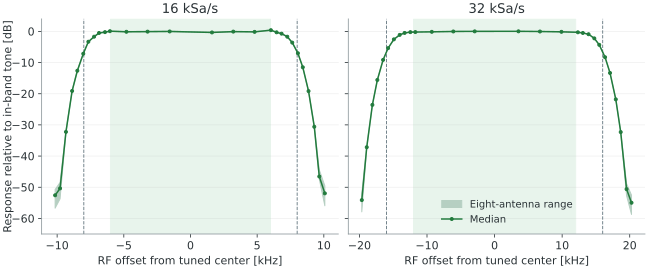

IQ Receive Streaming
====================

For a narrowband signal that may last seconds or minutes, ESPARGOS can
deliver consecutive complex samples from every receiving antenna. For
example, you can follow a carrier as it drifts or demodulate a signal that
crosses many block boundaries. For short events that need several MHz of
bandwidth, use the triggered captures in :doc:`iq-reception`.

Choose 16 kSa/s for signals within about 6 kHz either side of the tuned
frequency, or 32 kSa/s for about 12 kHz either side. These are complex
sample rates per antenna. The remaining spectrum near each Nyquist edge
is the filter's transition band.

   The shaded band shows where to place your signal. The dashed lines mark
   the Nyquist limits. Each point comes from an RF tone swept past the array
   at 2441 MHz. Each antenna's response is relative to its in-band level.

A peak at exactly zero frequency can come from the receiver's DC offset.
To distinguish it from a carrier, retune slightly. A received carrier moves
by the tuning offset, while the receiver's DC component stays at zero.

Receive a stream
----------------

This example tunes all eight sensors to 2437 MHz and prints the RMS amplitude
of each antenna in ADC counts. Replace the hostname with your controller's
address. Calibration uses the array's reference signal to align the receivers
before capture.

.. code-block:: python

   import numpy as np
   from espargos import Pool

   def report(block):
       rms = np.sqrt(np.mean(abs(block.iq) ** 2, axis=-1))
       if block.first_sample % 16000 == 0:
           print(block.first_sample, rms.round(1))

   with Pool("myspargel.local") as pool:
       pool.configure(mode="iq_rx", frequency_hz=2437e6,
                      sample_rate_hz=16000, output="antenna_r")
       pool.calibrate()
       pool.iq.add_stream_callback(report)
       pool.start_processing()
       input("Receiving. Press Enter to stop. ")

Each block contains 128 samples per antenna, or 8 ms at 16 kSa/s.
``block.iq[board, row, column]`` is a complex NumPy vector.
The samples retain their measured amplitude and phase. If you need calibrated phase
relationships, apply the receiver's frequency-domain correction as described
in :doc:`calibration`. Recalibrate after retuning or changing the sample rate.

Recording consecutive samples
-----------------------------

Place each block at ``block.first_sample`` in the recording. Adjacent blocks
are 128 samples apart. UDP can deliver blocks out of order, so a later
arrival may fill a gap. Keep any remaining gaps on the time axis. Joining
the samples across a gap introduces a false phase or frequency change.
Start a new recording segment after synchronization or a change of sample
rate or center frequency.

By default the callback receives a block when all active IQ receivers have
contributed. Pass ``include_partial=True`` to keep blocks with missing
antennas. Inspect ``block.completion`` to see which antennas contributed.
Missing samples are NaNs. Partial blocks may arrive after more recent
complete blocks, so use the sample index when assembling a recording.

To inspect a single sensor independently of synchronization, use
``board.iq.subscribe_stream(callback)``. Each message carries an
``antenna_id`` and a ``payload`` with the first sample index, sample rate
and a ``decode_iq()`` method. Free-running sensors have independent sample
indices. Use the calibrated pool callback for array measurements.

Signal analyzer
---------------

From the SDK checkout, run the signal analyzer to inspect the time trace,
spectrum or waterfall. The sample-rate argument is optional and defaults
to 16000.

.. code-block:: console

   $ python demos/iq/signal-analyzer/main.py myspargel.local --stream 16000
