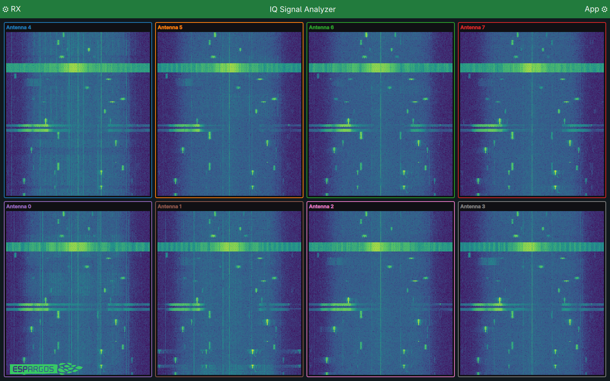

IQ Reception
============

ESPARGOS can capture raw complex (I/Q) samples, synchronized across its
antennas and boards. This uses an undocumented debug path in the ESP32 modem
that bypasses WiFi packet processing. Read about our discovery in the `ESP32
SDR write-up <https://espargos.net/espsdr/>`_.

Receive your first samples
--------------------------

Open a :class:`Pool <espargos.pool.Pool>`, configure reception and calibrate it. :attr:`pool.iq <espargos.pool.Pool.iq>` provides
the sample callbacks and trigger controls. See :doc:`calibration` for what
calibration measures and how to apply the corrections:

.. code-block:: python

   from espargos import Pool

   def handle_iq(cluster):
       print("Received IQ samples:", cluster.iq.shape)

   with Pool("192.168.1.2") as pool:
       pool.configure(mode="iq_rx", frequency_hz=2437e6,
                       sample_rate_hz=80e6, output="antenna_r")
       receiver = pool.iq
       receiver.apply_config({"trigger": {
           "mode": "interval", "interval_chunks": 16384,
           "offset_chunks": 0, "burst_chunks": 4,
       }})
       pool.calibrate()
       receiver.add_callback(handle_iq)
       pool.start_processing()
       input("Capturing. Press Enter to stop... ")

The callback receives matching samples from all antennas. :attr:`cluster.iq <espargos.iq_cluster.IQCluster.iq>` is a
complex NumPy array with shape ``(boards, rows, columns, 256)``. For one board,
that is ``(1, 2, 4, 256)``.

.. note::

   **Why 256 samples?** The firmware sends IQ samples in fixed blocks called
   *chunks*, each containing 256 complex samples per antenna. :class:`IQReceiver <espargos.iq_receiver.IQReceiver>` groups
   matching chunks from all antennas into one cluster. This is the transfer
   size, not a limit on capture length. For a longer waveform or FFT, combine
   consecutive chunks from the same capture burst. Four chunks give you 1024
   samples per antenna.

:meth:`pool.start_processing() <espargos.pool.Pool.start_processing>` starts one worker that processes both IQ and CSI
and invokes their registered callbacks.
Do not also call :meth:`run() <espargos.pool.Pool.run>` from your own loop while that thread is running.

Capture paths
-------------

Both modem paths can capture an arbitrary RF waveform. The WiFi path is useful
for wider signals. The Bluetooth path offers smaller analog bandwidths and can
sample down to 1.6 MSa/s. Selecting it does not require a Bluetooth transmitter.

.. list-table::
   :header-rows: 1

   * - Capture path
     - Complex sample rates (MSa/s)
     - Approximate analog bandwidth (MHz)
   * - WiFi
     - 80, 40, 20, 10, 8, 4
     - 13 to 54 in the 20 MHz channel configuration
   * - Bluetooth
     - 32, 16, 8, 4, 3.2, 1.6
     - 1.2 to 8.3 in 64 steps

For example, to capture a signal near 2467 MHz on all antennas::

   pool.configure(mode="iq_rx", frequency_hz=2467e6, capture_path="bluetooth",
                  sample_rate_hz=4e6, bandwidth_mhz=2.1)

The Bluetooth filter uses the nearest available setting. With the default centered filter, the bandwidths are approximate full widths around the tuned frequency. A 2.1 MHz filter
extends about 1.05 MHz to either side. Leave room for the filter to roll off
before the Nyquist frequency when strong signals occupy adjacent channels.
Changing the capture rate alone does not narrow the analog filter.

Use ``bluetooth_filter_mode="low_if"`` to receive a signal below the local
oscillator (LO) while attenuating interference at its mirror frequency. For
example, with the LO at 2437 MHz and ``bandwidth_mhz=3.4``, the measured
passband extends from about 2433.7 to 2436.6 MHz. A 2435 MHz tone appears at
−2 MHz in the IQ samples. Changing the filter does not shift the samples to
baseband. Choose a sample rate that covers the selected passband to avoid
aliasing. Continuous downsampling still selects frequencies around DC.
Set ``bluetooth_filter_mode="centered"`` to receive on both sides of the LO.

For phase-coherent capture, select the rate and filter first,
then call ``pool.calibrate()``. The SDK can reuse a live Bluetooth sample grid on a
single board. To establish a new common grid it briefly uses the WiFi path,
then measures Bluetooth phase and delay at the selected filter setting and
receiver gains. Depending on the passband and gain, it uses either two
independently tuned broadband references or four pilot tones.
A gain edit retains calibration. The physical phase response can still change
with gain, so calibrate at the intended operating gains for phase measurements.

The Trigger Modes
-----------------

Set ``trigger`` to an object with a mode name and its settings. This replaces
all trigger settings, using defaults for fields you leave out. Omit ``trigger``
to keep the current settings. :meth:`pool.boards[0].iq.get_config()["trigger"] <espargos.board_iq.IQCapability.get_config>` returns the
controller configuration, including defaults. To wait until every selected IQ
receiver has applied a change, use ``board.iq.set_config_and_wait(settings)``.
It returns the acknowledged generation, including for quiet triggers. A timeout
identifies the unconfirmed sensors. Ordinary ``board.iq.set_config(settings)``
returns when the controller accepts the write. For diagnostics,
``board.iq.get_rx_status()`` reports the generation and age in milliseconds
of each sensor's last acknowledgement, indexed by antenna ID. An unreported
generation is null. The status also includes per-antenna boot IDs.
Controller and sensor firmware with IQ configuration format 4 bind each timing
anchor to its sensor's boot ID. Update both firmware images together. If a
receiver restarts, it resumes free-running capture and needs a new reference
measurement before it can rejoin the synchronized array.

**Downsample** low-pass filters the input and delivers consecutive samples at a lower rate. See :doc:`iq-receive-streaming`
for the supported sample rates and callback.

**Interval** captures short bursts at regular intervals. Start here for general
signal inspection. The example above captures four 256-sample chunks every
16384 chunks, with no offset. Receive the samples with :meth:`add_callback() <espargos.iq_receiver.IQReceiver.add_callback>`.

**Accumulate** averages matching complex IQ samples from repeated waveforms
on each sensor before transfer. Its main application is :doc:`iq-radar`, where
coherent repetitions improve the visibility of weak reflections while reducing
data traffic. See :ref:`iq-accumulate` below for its requirements and settings.

**Batched accumulate** captures a sequence of closely spaced accumulated profiles
on a common grid. See :ref:`iq-batched-accumulate` for the schedule and callback.

**Signal** waits for a signal to cross a threshold, then captures the same
event across all eight antennas. This is useful for short bursts such as WiFi
traffic. Use :meth:`add_signal_capture_callback() <espargos.iq_receiver.IQReceiver.add_signal_capture_callback>` to receive complete captures.

.. note::

   Signal triggering coordinates the eight antennas within one ESPARGOS board.
   In a combined multi-array setup, each array triggers independently, even
   with a shared clock and reference connection. Their captures may therefore
   cover different events or different parts of the same signal.

   A multi-board :class:`Pool <espargos.pool.Pool>` acknowledges each board's
   Signal events independently, including when consuming raw chunks. Use a
   single-board pool for the complete-event callback. For synchronized captures
   across boards, use Interval or Accumulate.

For example:

.. code-block:: python

   receiver.apply_config({"trigger": {
       "mode": "signal",
       "threshold": 64,
       "antennas": list(range(8)),
       "holdoff_ms": 300,
       "capture_chunks": 56,
       "quiet_threshold": 0,
   }})

These are also the Signal defaults. ``antennas`` lists which antennas may
request a capture. A threshold is measured in ADC counts (I or Q). Set
``quiet_threshold`` above zero to require a quiet period before a new onset.
Unknown fields and settings for a different mode are rejected.

.. _iq-accumulate:

Accumulate mode
----------------

Accumulation requires coherent repetition: the signal must return with the
same sample alignment and stable phase on each repetition. There must be no
significant carrier-frequency offset (CFO) or sampling-frequency offset (SFO)
between TX and RX over the averaging window. CFO rotates the signal's phase;
SFO shifts its samples. Averaging does not compensate for either effect and
can weaken or blur a signal instead of improving it. Radar with a shared TX/RX
clock is the main use case. Unrelated transmissions generally do not meet
these conditions.

After moving sensors from another mode into IQ reception, call
``pool.calibrate()`` before collecting array averages. A sensor that has not
joined the sample grid can be present on the board but absent from the averages.

Choose ``vector_chunks`` so that ``vector_chunks * 256`` received samples cover
one waveform repetition, or an integer multiple of it. ``interval_chunks`` sets
the output interval in units of 256 received samples. For example::

   receiver.apply_config({"trigger": {
       "mode": "accumulate",
       "vector_chunks": 4,
       "interval_chunks": 32768,
       "offset_chunks": 0,
   }})
   receiver.add_accumulation_callback(handle_average)

This produces 1024-sample vectors at intervals of 32768 chunks.
:meth:`add_accumulation_callback() <espargos.iq_receiver.IQReceiver.add_accumulation_callback>`
delivers :class:`IQAccumCluster <espargos.iq_accum_cluster.IQAccumCluster>` objects;
:attr:`iq <espargos.iq_accum_cluster.IQAccumCluster.iq>` contains the averages.
By default, a callback receives a window only when all active receivers have
accumulated matching source chunks. This keeps their measurements comparable
when packets are lost or acquisition falls behind. At high input rates the
firmware selects a common stride between repetitions so all sensors can drain
their partial sums. Each packet reports the nominal and actual count per lane
and a hash of the source chunks used.

Longer averaging reduces uncorrelated noise, but also reduces the output rate
and can suppress signals whose phase changes during the window, including
reflections from moving targets. Choose the interval for the motion you need
to observe. Use Interval mode when you need individual, unaveraged captures.

.. _iq-batched-accumulate:

Batched accumulation
--------------------

Use short profiles to observe changes between repetitions, with a gap between
batches for readout. For example::

   receiver.apply_config({"trigger": {
       "mode": "batched_accumulate",
       "profile_length_chunks": 4,
       "profile_period_chunks": 24,
       "profiles_per_batch": 256,
       "batch_period_chunks": 24000,
   }})
   receiver.add_accumulation_callback(handle_average)

This captures 256 profiles spaced 24 source chunks apart in each batch. Each
callback delivers one profile of 1024 averaged complex samples per antenna.
Set the batch period to zero for automatic scheduling. With an explicit period,
divide the profile's ``source_chunk_start`` by the batch period using integer
division to identify its batch on the current chunk grid. Check source indices
for missing profiles before processing a batch. The fraction of input chunks
represented for each antenna is available as ``profile.input_coverage``. It is
the sum of its section counts divided by the profile period, counting missing
sections as zero. This excludes inter-batch gaps.

Signal Analyzer Demo
--------------------

From a checkout with the demo dependencies installed, run:

.. code-block:: console

   python demos/iq/signal-analyzer/main.py 192.168.1.2

Open **RX** to set the frequency, gain, and trigger mode. Use **App** to switch
between waterfalls, spectra, I/Q traces, and constellations.

   Signal-triggered traffic captured on an ESPARGOS array at 2437 MHz.
