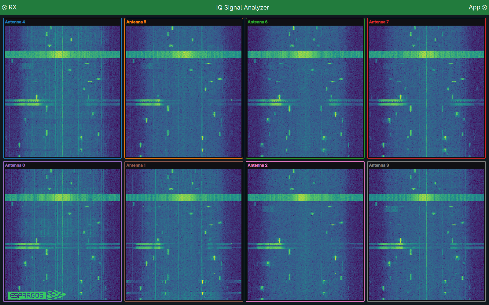

IQ Reception
============

ESPARGOS can capture raw complex (I/Q) samples, synchronized across its
antennas and boards. This uses an undocumented debug path in the ESP32 modem
that bypasses WiFi packet processing. Read about our discovery in the `ESP32
SDR write-up <https://espargos.net/espsdr/>`_.

Receive your first samples
--------------------------

Open a ``Pool``, configure reception and calibrate it. ``pool.iq`` provides
the sample callbacks and trigger controls. See :doc:`calibration` for what
calibration measures and how to apply the corrections:

.. code-block:: python

   from espargos import Pool

   def handle_iq(cluster):
       print("Received IQ samples:", cluster.iq.shape)

   with Pool("192.168.1.2") as pool:
       pool.configure(mode="iq_rx", frequency_hz=2437e6,
                       sample_rate_hz=80e6, output="antenna_r")
       receiver = pool.iq
       receiver.apply_config({"trigger": {
           "mode": "interval", "interval_chunks": 16384,
           "offset_chunks": 0, "burst_chunks": 4,
       }})
       pool.calibrate()
       receiver.add_callback(handle_iq)
       pool.start_processing()
       input("Capturing. Press Enter to stop... ")

The callback receives matching samples from all antennas. ``cluster.iq`` is a
complex NumPy array with shape ``(boards, rows, columns, 256)``. For one board,
that is ``(1, 2, 4, 256)``.

.. note::

   **Why 256 samples?** The firmware sends IQ samples in fixed blocks called
   *chunks*, each containing 256 complex samples per antenna. ``IQReceiver`` groups
   matching chunks from all antennas into one cluster. This is the transfer
   size, not a limit on capture length. For a longer waveform or FFT, combine
   consecutive chunks from the same capture burst. Four chunks give you 1024
   samples per antenna.

``pool.start_processing()`` starts one worker that processes both IQ and CSI
and invokes their registered callbacks.
Do not also call ``run()`` from your own loop while that thread is running.

The Trigger Modes
-----------------

Set ``trigger`` to an object with a mode name and its settings. This replaces
all trigger settings, using defaults for fields you leave out. Omit ``trigger``
to keep the current settings. ``pool.boards[0].iq.get_config()["trigger"]`` returns the
full applied configuration, including defaults.

**Interval** captures short bursts at regular intervals. Start here for general
signal inspection. The example above captures four 256-sample chunks every
16384 chunks, with no offset. Receive the samples with ``add_callback()``.

**Accumulate** averages repeated waveforms to make a weak repeating signal
easier to see. ``{"mode": "accumulate", "vector_chunks": 4, "interval_chunks":
32768, "offset_chunks": 0}`` selects four-chunk vectors and an output interval
of 32768 chunks. Use ``add_accumulation_callback()`` to receive the averages.

**Signal** waits for a signal to cross a threshold, then captures the same
event across all eight antennas. This is useful for short bursts such as WiFi
traffic. Use ``add_signal_capture_callback()`` to receive complete captures.

.. note::

   Signal triggering coordinates the eight antennas within one ESPARGOS board.
   In a combined multi-array setup, each array triggers independently, even
   with a shared clock and reference connection. Their captures may therefore
   cover different events or different parts of the same signal.

   Use a single-board ``Pool`` for Signal capture. For synchronized captures
   across multiple arrays, use Interval or Accumulate instead.

For example:

.. code-block:: python

   receiver.apply_config({"trigger": {
       "mode": "signal",
       "threshold": 64,
       "antennas": list(range(8)),
       "holdoff_ms": 300,
       "capture_chunks": 56,
       "quiet_threshold": 0,
   }})

These are also the Signal defaults. ``antennas`` lists which antennas may
request a capture. A threshold is measured in ADC counts (I or Q). Set
``quiet_threshold`` above zero to require a quiet period before a new onset.
Unknown fields and settings for a different mode are rejected.

Signal Analyzer Demo
--------------------

From a checkout with the demo dependencies installed, run:

.. code-block:: console

   python demos/iq-signal-analyzer/iq-signal-analyzer.py 192.168.1.2

Open **RX** to set the frequency, gain, and trigger mode. Use **App** to switch
between waterfalls, spectra, I/Q traces, and constellations.

   Signal-triggered traffic captured on an ESPARGOS array at 2437 MHz.
