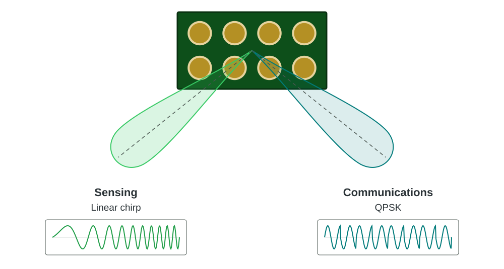

IQ Transmission
===============

   ESPARGOS is a digital phased array, so it can form multiple beams at once.
   Each sensor transmits the sum of its contributions to the beams. Each beam
   can have its own waveform and direction.

.. warning::

   **Authorization to transmit is required.**

   Enable transmit authorization in the controller's Settings only after
   confirming that you are legally permitted to transmit with the selected
   frequency, bandwidth, power and antenna configuration. IQ transmission is
   experimental and can produce high EIRP. Use this feature at your own risk.

We can transmit repeating IQ waveforms from selected ESPARGOS sensors. Each
sensor replays its buffer continuously at 80, 40, 32 or 16 MSa/s. A **signal** combines a
waveform, an amplitude, an antenna selection and optional steering. We can
steer it across an array as a beam, or send unrelated signals from individual
antennas. Each antenna transmits the sum of the signals assigned to it.

Digital amplitude is a sample scale, not a calibrated output-power setting.
The Python API does not impose the demo's recommended power limits. Start
with low digital amplitude and RF gains.

Transmit a tone
---------------

:class:`Pool <espargos.pool.Pool>` owns the boards and connections. We configure the radios through the
pool and add signals through :attr:`pool.tx.signals <espargos.iq_transmitter.IQTransmitter.signals>`. This example uses the
Reference port:

.. code-block:: python

   from espargos import Pool
   from espargos.waveforms import CW

   with Pool("192.168.1.2") as pool:
       pool.configure(mode="iq_tx", frequency_hz=2380e6,
                      bandwidth_mhz=40, rf_gain={"a": 0, "b": 0},
                      output="reference")
       tx = pool.tx
       tone = tx.signals.add(waveform=CW(offset_hz=1.25e6), amplitude=0.05)
       pool.calibrate(tx_method="reciprocity")

       pool.start_transmission()
       input("Transmitting. Press Enter to mute... ")
       pool.stop_transmission()

By default a signal uses the sensors currently in IQ TX mode. It keeps that
antenna selection until you change it. Each antenna starts with unit weight
and retains its calibration corrections.

The default loop contains 1024 samples. Set :attr:`tx.samples <espargos.iq_transmitter.IQTransmitter.samples>`
to a power of two from 256 to 8192. The signals on an array share the loop
length and playback rate. The default rate is 80 MSa/s. For example, call
``pool.configure(sample_rate_hz=16_000_000)`` with the sensors in IQ TX mode
to select 16 MSa/s. On a board with both transmitters and receivers, include
every active transmitter in the selection. The receivers keep their own rate.
Changing the TX rate mutes the array. Reapply the signals and calibrate
before starting transmission again.

The replay period is ``tx.samples / sample_rate_hz``, independent of the receive
capture interval. At 8192 samples it is 102.4, 204.8, 256 or 512 µs at
80, 40, 32 or 16 MSa/s respectively. Changing the length can also invalidate
calibration. Waveform frequencies and durations retain their physical units at every
rate. Raw IQ sample arrays are played at the selected rate without resampling.
Below 80 MSa/s, use ``pool.calibrate(tx_method="monitor")``. Reciprocal
calibration and reuse of calibration across replay restarts require 80 MSa/s:
the slower replay start has a sample ambiguity that its timestamp does not
resolve. The monitor measures the final running transmitters directly.

To send a live waveform or a sequence of symbols from your computer, see
:doc:`iq-transmit-streaming`.

An individual array can also use ``tx_method="monitor"`` for calibration.
See :doc:`calibration` for the two methods and their requirements.

To transmit through an antenna feed, configure ``output="antenna_r"`` or
``"antenna_l"`` instead. ``"isolated"`` disconnects both antennas and Reference.
The legacy spelling ``"isolation"`` is also accepted by ``configure()``.
Stopping transmission replaces the samples with silence while replay keeps
running, preserving calibration timing. Closing the pool also stops TX.

Choose a waveform
-----------------

The standard waveforms are synthesized on each sensor. We send their
parameters instead of uploading a buffer of samples, which allows faster
waveform switching.

Waveforms contain only source parameters. Amplitude and steering belong to
the signal, while frequency, RF gain, bandwidth and output feed belong to the
radio configuration.

.. list-table::
   :header-rows: 1
   :widths: 25 75

   * - Waveform
     - Example
   * - Complex tone
     - :class:`CW(offset_hz=1e6) <espargos.waveforms.CW>`
   * - Two tones
     - :class:`TwoTone(first_hz=-1e6, second_hz=1e6) <espargos.waveforms.TwoTone>`
   * - Linear chirp
     - :class:`LFM(start_hz=-40e6, stop_hz=40e6, duration_s=0.4e-6, delay_s=0) <espargos.waveforms.LFM>`
   * - Repeating noise
     - :class:`Noise(seed=123) <espargos.waveforms.Noise>`
   * - Repeating QPSK sequence
     - :class:`QPSK(seed=123) <espargos.waveforms.QPSK>`
   * - Uploaded IQ samples
     - :class:`IQSamples(complex_samples) <espargos.waveforms.IQSamples>` or :meth:`IQSamples.from_file("signal.npy") <espargos.waveforms.IQSamples.from_file>`

Two tones have equal amplitude. Their offsets are independent and measured
relative to the radio's center frequency, each within half the selected sample
rate (for example, ±8 MHz at 16 MSa/s). The examples above use
the default 80 MSa/s rate.

We can replace a signal's waveform directly::

   from espargos.waveforms import LFM

   tone.waveform = LFM(duration_s=0.4e-6, delay_s=1e-6)

Chirp duration and delay must use whole samples (12.5 ns at 80 MSa/s,
25 ns at 40 MSa/s, 31.25 ns at 32 MSa/s, 62.5 ns at 16 MSa/s) and fit
inside the replay buffer. The remainder of the buffer is silent.

:class:`IQSamples <espargos.waveforms.IQSamples>` copies a one-dimensional complex array and quantizes it once.
Each I and Q value must lie within ±1. Files may contain a complex NumPy array
or two columns of I/Q values in CSV or whitespace-separated text. The sample
count must match :attr:`tx.samples <espargos.iq_transmitter.IQTransmitter.samples>`. Values retain their scale unless we explicitly
request :meth:`IQSamples.from_file(path, normalize=True) <espargos.waveforms.IQSamples.from_file>`.

These sources repeat. Noise and QPSK waveforms do not generate a continuing
stream of new data.

Synthesize samples in Python
~~~~~~~~~~~~~~~~~~~~~~~~~~~~

Each waveform also provides :meth:`synthesize() <espargos.waveforms.Waveform.synthesize>`. We can inspect its samples
without connecting to an array, use them in a simulation, or save them to a
file::

   import numpy as np
   from espargos.waveforms import LFM

   chirp = LFM(start_hz=-20e6, stop_hz=20e6, duration_s=1e-6,
               delay_s=0.2e-6)
   iq = chirp.synthesize(samples=256)
   time_s = np.arange(iq.size) / 80e6
   np.save("chirp.npy", iq)

The result is a complex NumPy array in full-scale units, before signal
amplitude, steering and calibration. Pass ``sample_rate_hz=40e6`` to
``synthesize`` for a 40 MSa/s offline preview (the default is 80 MSa/s).
Synthesis follows the sensor's frequency
rounding and sample quantization. Tone and chirp frequencies are rounded to
multiples of ``sample_rate_hz / samples``. Noise and QPSK use the same seeded sequence as
the sensor. :meth:`IQSamples.synthesize() <espargos.waveforms.Waveform.synthesize>` returns the quantized uploaded samples.

.. figure:: _static/iq-lfm.svg
   :alt: In-phase and quadrature samples of a delayed linear chirp
   :align: center

   I and Q for the chirp above. The 1 µs sweep starts after a 0.2 µs delay,
   followed by silence until the replay buffer repeats at 3.2 µs.

Steer one or more beams
-----------------------

We create a beam by giving a signal a :class:`Beamspace <espargos.steering.Beamspace>` steering configuration:

.. code-block:: python

   from espargos.steering import Beamspace
   from espargos.waveforms import CW

   beam = tx.signals.add(
       waveform=CW(offset_hz=1e6),
       amplitude=0.05,
       steering=Beamspace(azimuth_deg=20, elevation_deg=0),
   )
   beam.steering = Beamspace(azimuth_deg=-15, elevation_deg=5)

Angles are in degrees, viewed outward from the array. Zero azimuth and
elevation point straight out from its face (broadside).

The array steers each beam with phase shifts at the transmit frequency. For a CW
signal, the SDK includes the tone offset when calculating the phase.

You can change a beam’s direction or amplitude without uploading its waveform again.

We can add several signals with different waveforms and directions. The
library does not divide amplitudes by the number of signals. Each sensor
supports up to four contributions, and the sum of their amplitude-weight
magnitudes must not exceed one. Requests exceeding these limits raise an
error rather than silently rescaling the signals.

Beamspace steering across boards requires their antenna positions, a shared
clock and reference distribution. For a combined aperture, load its layout::

   with Pool.from_config("config/aperture-kit-8x4.yml") as pool:
       pool.configure(mode="iq_tx", frequency_hz=2380e6)
       tx = pool.tx
       # Add signals, calibrate and start as above.

For rapid, timed changes of direction, see :doc:`iq-beam-steering`.

Independent antenna signals and custom weights
-----------------------------------------------

The four-contribution limit applies per sensor, not per pool. We can therefore
assign a different waveform to every sensor in an aperture kit:

.. code-block:: python

   from espargos.waveforms import CW

   with tx.update():
       tx.signals.clear()
       for index, antenna in enumerate(pool.antennas):
           tx.signals.add(
               waveform=CW(offset_hz=(index + 1) * 625e3),
               amplitude=0.01,
               antennas=[antenna],
           )

``antennas`` accepts :class:`Antenna <espargos.calibration.Antenna>` objects or a selection such as
:meth:`pool.select(boards=["ba1"], antennas=[0, 1]) <espargos.pool.Pool.select>`. Every selected sensor must be
in IQ TX mode. We can change a signal's selection with
:meth:`signal.update(antennas=selection) <espargos.tx_signal.TXSignal.update>`.

For custom spatial weights, we use :class:`Weights <espargos.steering.Weights>` instead of :class:`Beamspace <espargos.steering.Beamspace>`::

   from espargos.steering import Weights

   signal.steering = Weights(
       {antenna_a: 1.0, antenna_b: 0.5j},
   )

Unspecified antennas use unit weight. Each sensor applies its weight after calibration. Starting a geometric beam requires valid TX
corrections with a common reference for its antennas. Independently calibrated
groups must be calibrated together before using them in the same beam.
Waveforms can still be prepared before calibration. Explicit
:class:`Weights <espargos.steering.Weights>` leave phase alignment to the caller.

:class:`Beamspace <espargos.steering.Beamspace>` uses the antenna positions
from :meth:`Pool.from_config() <espargos.pool.Pool.from_config>`. For a custom
geometry, calculate one complex weight per antenna and pass the mapping to
:class:`Weights <espargos.steering.Weights>`.

Updating and removing signals
------------------------------

Signal edits normally apply immediately. A handle remains valid until we
remove it::

   beam.amplitude = 0.02
   beam.remove()
   tx.signals.clear()

Removing a signal recomputes the affected sensors' buffers. If no signal
remains on a sensor, it replays silence.

We can batch several edits into one update::

   with tx.update():
       first.steering = Beamspace(azimuth_deg=15)
       second.amplitude = 0.03

The library validates the whole configuration before sending waveform commands.
Immediate updates reach sensors as the commands arrive. To apply them at a
shared replay boundary, use :meth:`tx.update(start_sample=boundary) <espargos.iq_transmitter.IQTransmitter.update>`. The boundary
is a sample number on the synchronized replay timeline and must be a multiple
of :attr:`tx.samples <espargos.iq_transmitter.IQTransmitter.samples>`. Allow enough time to transfer and prepare every contribution.
Scheduled updates require running, synchronized TX and an unchanged replay
length. The firmware switches buffers in software, so the actual switch can
lag the requested boundary slightly. :meth:`tx.read() <espargos.iq_transmitter.IQTransmitter.read>` reports each sensor's
``applied_sample``. Scheduling does not provide a rollback of commands already
sent if a later device fails.

Calls are blocking. Use one control thread for configuration, signal edits and
calibration. In a GUI, that should be a worker thread. Capture callbacks should
queue data for processing rather than reconfigure hardware.

Reference monitor
-----------------

The reference monitor captures short bursts from the master board's controller
(or the standalone board's controller), independently of sensor transmission.
We configure it through the pool::

   monitor = pool.configure_monitor({"enabled": True})
   bursts = monitor.collect(count=3)
   pool.configure_monitor({"enabled": False})

:meth:`collect() <espargos.reference_monitor.ReferenceMonitor.collect>` returns fresh complex sample arrays. Closing the pool stops its
monitor and releases the subscription.

IQ Transmit Beamforming Demo
----------------------------

From the pyespargos checkout, with the demo dependencies installed::

   ./demos/iq/transmit-beamforming/main.py -s 192.168.1.2

For the aperture kit::

   ./demos/iq/transmit-beamforming/main.py -c config/aperture-kit-8x4.yml

The demo selects IQ TX on all sensors, calibrates at startup, then starts
transmitting on the right antenna feed. Each beam tab controls one signal.
We can choose its waveform and drag its handle in the beamspace plot. The demo
shares the amplitude budget between beams by dividing the selected amplitude
by the beam count. The reference monitor has a separate start/stop control.
Closing the demo mutes the transmitters.

See :doc:`iq-radar` for simultaneous IQ reception, orthogonal pilots and
TX–RX timing calibration.
