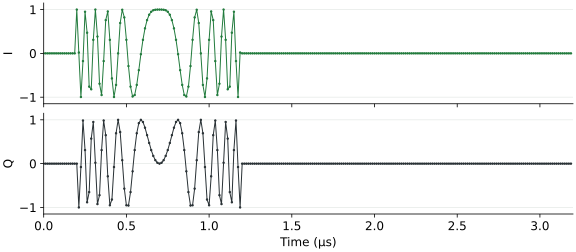

IQ Transmission
===============

.. warning::

   **Authorization to transmit is required.**

   Enable transmit authorization in the controller's Settings only after
   confirming that you are legally permitted to transmit with the selected
   frequency, bandwidth, power and antenna configuration. IQ transmission is
   experimental and can produce high EIRP. Use this feature at your own risk.

We can transmit repeating IQ waveforms from selected ESPARGOS sensors. Each
sensor replays its buffer continuously at 80 MSa/s. A **signal** combines a
waveform, an amplitude, an antenna selection and optional steering. We can
steer it across an array as a beam, or send unrelated signals from individual
antennas. Each antenna transmits the sum of the signals assigned to it.

Digital amplitude is a sample scale, not a calibrated output-power setting.
The Python API does not impose the demo's recommended power limits. Start
with low digital amplitude and RF gains.

Transmit a tone
---------------

``Pool`` owns the boards and connections. We configure the radios through the
pool and add signals through ``pool.tx.signals``. This example uses the
Reference port:

.. code-block:: python

   from espargos import Pool
   from espargos.waveforms import CW

   with Pool("192.168.1.2") as pool:
       pool.configure(mode="iq_tx", frequency_hz=2380e6,
                      bandwidth_mhz=40, rf_gain={"a": 0, "b": 0},
                      output="reference")
       tx = pool.tx
       tone = tx.signals.add(waveform=CW(offset_hz=1.25e6), amplitude=0.05)
       pool.calibrate(tx_method="reciprocity")

       pool.start_transmission()
       input("Transmitting. Press Enter to mute... ")
       pool.stop_transmission()

Without an explicit antenna selection, a signal uses the sensors currently
in IQ TX mode. That selection stays with the signal until we change it.
Without steering, all selected antennas use unit weights and zero additional
delay. Calibration corrections still apply.

The default replay length is 1024 samples. We can set ``tx.samples`` to a power
of two from 256 to 8192. All signals share this length and the 80 MSa/s sample
rate. Changing the length can invalidate calibration.

An individual array can also use ``tx_method="monitor"`` for calibration.
See :doc:`calibration` for the two methods and their requirements.

To transmit through an antenna feed, configure ``output="antenna_r"`` or
``"antenna_l"`` instead. ``"isolation"`` selects neither antenna nor Reference.
Stopping transmission replaces the samples with silence while replay keeps
running, preserving calibration timing. Closing the pool also stops TX.

Choose a waveform
-----------------

The standard waveforms are synthesized on each sensor. We send their
parameters instead of uploading a buffer of samples, which allows faster
waveform switching. The available waveform types may change in future
firmware and library releases.

Waveforms contain only source parameters. Amplitude and steering belong to
the signal, while frequency, RF gain, bandwidth and output feed belong to the
radio configuration.

.. list-table::
   :header-rows: 1
   :widths: 25 75

   * - Waveform
     - Example
   * - Complex tone
     - ``CW(offset_hz=1e6)``
   * - Two tones
     - ``TwoTone(first_hz=-1e6, second_hz=1e6)``
   * - Linear chirp
     - ``LFM(start_hz=-40e6, stop_hz=40e6, duration_s=0.4e-6, delay_s=0)``
   * - Repeating noise
     - ``Noise(seed=123)``
   * - Repeating QPSK sequence
     - ``QPSK(seed=123)``
   * - Uploaded IQ samples
     - ``IQSamples(complex_samples)`` or ``IQSamples.from_file("signal.npy")``

Two tones have equal amplitude. Their offsets are independent and measured
relative to the radio's center frequency, each within ±40 MHz.

We can replace a signal's waveform directly::

   from espargos.waveforms import LFM

   tone.waveform = LFM(duration_s=0.4e-6, delay_s=1e-6)

Chirp duration and delay must use whole samples, in steps of 12.5 ns, and fit
inside the replay buffer. The remainder of the buffer is silent.

``IQSamples`` copies a one-dimensional complex array and quantizes it once.
Each I and Q value must lie within ±1. Files may contain a complex NumPy array
or two columns of I/Q values in CSV or whitespace-separated text. The sample
count must match ``tx.samples``. Values retain their scale unless we explicitly
request ``IQSamples.from_file(path, normalize=True)``.

These sources repeat. Noise and QPSK waveforms do not generate a continuing
stream of new data.

Synthesize samples in Python
~~~~~~~~~~~~~~~~~~~~~~~~~~~~

Each waveform also provides ``synthesize()``. We can inspect its samples
without connecting to an array, use them in a simulation, or save them to a
file::

   import numpy as np
   from espargos.waveforms import LFM

   chirp = LFM(start_hz=-20e6, stop_hz=20e6, duration_s=1e-6,
               delay_s=0.2e-6)
   iq = chirp.synthesize(samples=256)
   time_s = np.arange(iq.size) / 80e6
   np.save("chirp.npy", iq)

The result is a complex NumPy array in full-scale units, before signal
amplitude, steering and calibration. Synthesis follows the sensor's frequency
rounding and sample quantization. Tone and chirp frequencies are rounded to
multiples of ``80e6 / samples``. Noise and QPSK use the same seeded sequence as
the sensor. ``IQSamples.synthesize()`` returns the quantized uploaded samples.

   I and Q for the chirp above. The 1 µs sweep starts after a 0.2 µs delay,
   followed by silence until the replay buffer repeats at 3.2 µs.

Steer one or more beams
-----------------------

We create a beam by giving a signal a ``Beamspace`` steering configuration:

.. code-block:: python

   from espargos.steering import Beamspace
   from espargos.waveforms import CW

   beam = tx.signals.add(
       waveform=CW(offset_hz=1e6),
       amplitude=0.05,
       steering=Beamspace(azimuth_deg=20, elevation_deg=0),
   )
   beam.steering = Beamspace(azimuth_deg=-15, elevation_deg=5, squint=True)

Angles are in degrees, viewed outward from the array. Zero azimuth and
elevation point broadside. ``squint=True`` adds geometric fractional delays
for wideband steering. For a CW signal without squint correction, we compute
phase weights at its carrier-plus-offset frequency. Otherwise we use the
carrier frequency, with fractional delays accounting for frequency-dependent
steering when enabled.

Sensors cache their source waveforms. Changing steering or amplitude reuses
the source rather than uploading or synthesizing it again. Changing a delay
also updates the delayed waveform.

We can add several signals with different waveforms and directions. The
library does not divide amplitudes by the number of signals. Each sensor
supports up to four contributions, and the sum of their amplitude-weight
magnitudes must not exceed one. Requests exceeding these limits raise an
error rather than silently rescaling the signals.

Beamspace steering across boards requires their antenna positions, a shared
clock and reference distribution. For a combined aperture, load its layout::

   with Pool.from_config("config/aperture-kit-8x4.yml") as pool:
       pool.configure(mode="iq_tx", frequency_hz=2380e6)
       tx = pool.tx
       # Add signals, calibrate and start as above.

Independent antenna signals and custom weights
-----------------------------------------------

The four-contribution limit applies per sensor, not per pool. We can therefore
assign a different waveform to every sensor in an aperture kit:

.. code-block:: python

   from espargos.waveforms import CW

   with tx.update():
       tx.signals.clear()
       for index, antenna in enumerate(pool.antennas):
           tx.signals.add(
               waveform=CW(offset_hz=(index + 1) * 625e3),
               amplitude=0.01,
               antennas=[antenna],
           )

``antennas`` accepts ``Antenna`` objects or a selection such as
``pool.select(boards=["ba1"], antennas=[0, 1])``. Every selected sensor must be
in IQ TX mode. We can change a signal's selection with
``signal.update(antennas=selection)``.

For custom spatial weights, we use ``Weights`` instead of ``Beamspace``::

   from espargos.steering import Weights

   signal.steering = Weights(
       {antenna_a: 1.0, antenna_b: 0.5j},
       delays_s={antenna_b: 12.5e-9},
   )

Unspecified antennas use unit weight and zero delay. We apply these weights and delays in addition to the calibration corrections.
They do not replace calibration.

Updating and removing signals
------------------------------

Signal edits normally apply immediately. A handle remains valid until we
remove it::

   beam.amplitude = 0.02
   beam.remove()
   tx.signals.clear()

Removing a signal recomputes the affected sensors' buffers. If no signal
remains on a sensor, it replays silence.

We can batch several edits into one update::

   with tx.update():
       first.steering = Beamspace(azimuth_deg=15)
       second.amplitude = 0.03

The library validates the whole configuration before sending waveform commands.
Immediate updates reach sensors as the commands arrive. To apply them at a
shared replay boundary, use ``tx.update(start_sample=boundary)``. The boundary
is a sample number on the synchronized replay timeline and must be a multiple
of ``tx.samples``. Allow enough time to transfer and prepare every contribution.
Scheduled updates require running, synchronized TX and an unchanged replay
length. The firmware switches buffers in software, so the actual switch can
lag the requested boundary slightly. ``tx.read()`` reports each sensor's
``applied_sample``. Scheduling does not provide a rollback of commands already
sent if a later device fails.

Calls are blocking. In a GUI, run hardware operations on a worker thread.

Reference monitor
-----------------

The reference monitor captures short bursts from the master board's controller
(or the standalone board's controller), independently of sensor transmission.
We configure it through the pool::

   monitor = pool.configure_monitor({"enabled": True})
   bursts = monitor.collect(count=3)
   pool.configure_monitor({"enabled": False})

``collect()`` returns fresh complex sample arrays. Closing the pool stops its
monitor and releases the subscription.

IQ Transmit Beamforming Demo
----------------------------

From the pyespargos checkout, with the demo dependencies installed::

   ./demos/iq-transmit-beamforming/iq-transmit-beamforming.py -s 192.168.1.2

For the aperture kit::

   ./demos/iq-transmit-beamforming/iq-transmit-beamforming.py -c config/aperture-kit-8x4.yml

The demo selects IQ TX on all sensors, calibrates at startup, then starts
transmitting on the right antenna feed. Each beam tab controls one signal.
We can choose its waveform and drag its handle in the beamspace plot. The demo
shares the amplitude budget between beams by dividing the selected amplitude
by the beam count. The reference monitor has a separate start/stop control.
Closing the demo mutes the transmitters.
