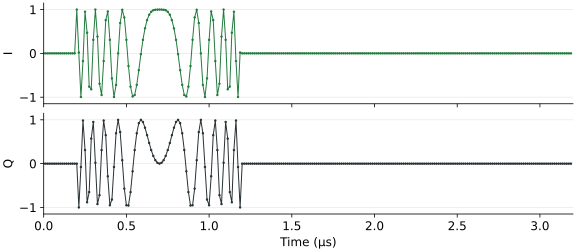

IQ Transmission
===============

.. figure:: _static/iq-beams.svg
   :alt: One ESPARGOS array steering a sensing chirp left and a communications waveform right
   :align: center

   ESPARGOS is a digital phased array, so it can form multiple beams at once.
   Each sensor transmits the sum of its contributions to the beams. Each beam
   can have its own waveform and direction.

.. warning::

   **Authorization to transmit is required.**

   Enable transmit authorization in the controller's Settings only after
   confirming that you are legally permitted to transmit with the selected
   frequency, bandwidth, power and antenna configuration. IQ transmission is
   experimental and can produce high EIRP. Use this feature at your own risk.

We can transmit repeating IQ waveforms from selected ESPARGOS sensors. Each
sensor replays its buffer continuously at 80, 40, 32 or 16 MSa/s. A **signal** combines a
waveform, an amplitude, an antenna selection and optional steering. We can
steer it across an array as a beam, or send unrelated signals from individual
antennas. Each antenna transmits the sum of the signals assigned to it.

Digital amplitude is a sample scale, not a calibrated output-power setting.
The Python API does not impose the demo's recommended power limits. Start
with low digital amplitude and RF gains.

Transmit a tone
---------------

:class:`Pool <espargos.pool.Pool>` owns the boards and connections. We configure the radios through the
pool and add signals through :attr:`pool.tx.signals <espargos.iq_transmitter.IQTransmitter.signals>`. This example uses the
Reference port:

.. code-block:: python

   from espargos import Pool
   from espargos.waveforms import CW

   with Pool("192.168.1.2") as pool:
       pool.configure(mode="iq_tx", frequency_hz=2380e6,
                      bandwidth_mhz=40, rf_gain={"a": 0, "b": 0},
                      output="reference")
       tx = pool.tx
       tone = tx.signals.add(waveform=CW(offset_hz=1.25e6), amplitude=0.05)
       pool.calibrate(tx_method="reciprocity")

       pool.start_transmission()
       input("Transmitting. Press Enter to mute... ")
       pool.stop_transmission()

Without an explicit antenna selection, a signal uses the sensors currently
in IQ TX mode. That selection stays with the signal until we change it.
Without steering, all selected antennas use unit weights and zero additional
delay. Calibration corrections still apply.

The default replay length is 1024 samples. We can set :attr:`tx.samples <espargos.iq_transmitter.IQTransmitter.samples>` to a power
of two from 256 to 8192. All signals on an array share this length and the
selected sample rate (80, 40, 32 or 16 MSa/s). Select 16 MSa/s with
``pool.configure(sample_rate_hz=16_000_000)`` while the array is in IQ TX mode; the default is 80 MSa/s. The setting applies
to all transmitters on an array. For mixed RX/TX roles, select every active
IQ TX sensor when changing the TX rate; receivers retain their own rate.
Changing it mutes transmission and invalidates TX calibration. Reapply the signals and calibrate before restarting transmission.

The replay period is ``tx.samples / sample_rate_hz``, independent of the receive
capture interval. At 8192 samples it is 102.4, 204.8, 256 or 512 µs at
80, 40, 32 or 16 MSa/s respectively. Changing the length can also invalidate
calibration. Waveform frequencies, durations and steering delays retain their physical units at every
rate. Raw IQ sample arrays are played at the selected rate without resampling.
Below 80 MSa/s, use ``pool.calibrate(tx_method="monitor")``. Reciprocal
calibration and reuse of calibration across replay restarts require 80 MSa/s:
the slower replay start has a sample ambiguity that its timestamp does not
resolve. The monitor measures the final running transmitters directly.

These signals repeat. The buffered streaming interface below adds one
continuing source without replacing the stored beam scene.

An individual array can also use ``tx_method="monitor"`` for calibration.
See :doc:`calibration` for the two methods and their requirements.

To transmit through an antenna feed, configure ``output="antenna_r"`` or
``"antenna_l"`` instead. ``"isolation"`` selects neither antenna nor Reference.
Stopping transmission replaces the samples with silence while replay keeps
running, preserving calibration timing. Closing the pool also stops TX.

Choose a waveform
-----------------

The standard waveforms are synthesized on each sensor. We send their
parameters instead of uploading a buffer of samples, which allows faster
waveform switching.

Waveforms contain only source parameters. Amplitude and steering belong to
the signal, while frequency, RF gain, bandwidth and output feed belong to the
radio configuration.

.. list-table::
   :header-rows: 1
   :widths: 25 75

   * - Waveform
     - Example
   * - Complex tone
     - :class:`CW(offset_hz=1e6) <espargos.waveforms.CW>`
   * - Two tones
     - :class:`TwoTone(first_hz=-1e6, second_hz=1e6) <espargos.waveforms.TwoTone>`
   * - Linear chirp
     - :class:`LFM(start_hz=-40e6, stop_hz=40e6, duration_s=0.4e-6, delay_s=0) <espargos.waveforms.LFM>`
   * - Repeating noise
     - :class:`Noise(seed=123) <espargos.waveforms.Noise>`
   * - Repeating QPSK sequence
     - :class:`QPSK(seed=123) <espargos.waveforms.QPSK>`
   * - Uploaded IQ samples
     - :class:`IQSamples(complex_samples) <espargos.waveforms.IQSamples>` or :meth:`IQSamples.from_file("signal.npy") <espargos.waveforms.IQSamples.from_file>`

Two tones have equal amplitude. Their offsets are independent and measured
relative to the radio's center frequency, each within half the selected sample
rate (for example, ±8 MHz at 16 MSa/s). The examples above use
the default 80 MSa/s rate.

We can replace a signal's waveform directly::

   from espargos.waveforms import LFM

   tone.waveform = LFM(duration_s=0.4e-6, delay_s=1e-6)

Chirp duration and delay must use whole samples (12.5 ns at 80 MSa/s,
25 ns at 40 MSa/s, 31.25 ns at 32 MSa/s, 62.5 ns at 16 MSa/s) and fit
inside the replay buffer. The remainder of the buffer is silent.

:class:`IQSamples <espargos.waveforms.IQSamples>` copies a one-dimensional complex array and quantizes it once.
Each I and Q value must lie within ±1. Files may contain a complex NumPy array
or two columns of I/Q values in CSV or whitespace-separated text. The sample
count must match :attr:`tx.samples <espargos.iq_transmitter.IQTransmitter.samples>`. Values retain their scale unless we explicitly
request :meth:`IQSamples.from_file(path, normalize=True) <espargos.waveforms.IQSamples.from_file>`.

These sources repeat. Noise and QPSK waveforms do not generate a continuing
stream of new data.

Synthesize samples in Python
~~~~~~~~~~~~~~~~~~~~~~~~~~~~

Each waveform also provides :meth:`synthesize() <espargos.waveforms.Waveform.synthesize>`. We can inspect its samples
without connecting to an array, use them in a simulation, or save them to a
file::

   import numpy as np
   from espargos.waveforms import LFM

   chirp = LFM(start_hz=-20e6, stop_hz=20e6, duration_s=1e-6,
               delay_s=0.2e-6)
   iq = chirp.synthesize(samples=256)
   time_s = np.arange(iq.size) / 80e6
   np.save("chirp.npy", iq)

The result is a complex NumPy array in full-scale units, before signal
amplitude, steering and calibration. Pass ``sample_rate_hz=40e6`` to
``synthesize`` for a 40 MSa/s offline preview (the default is 80 MSa/s).
Synthesis follows the sensor's frequency
rounding and sample quantization. Tone and chirp frequencies are rounded to
multiples of ``sample_rate_hz / samples``. Noise and QPSK use the same seeded sequence as
the sensor. :meth:`IQSamples.synthesize() <espargos.waveforms.Waveform.synthesize>` returns the quantized uploaded samples.

   I and Q for the chirp above. The 1 µs sweep starts after a 0.2 µs delay,
   followed by silence until the replay buffer repeats at 3.2 µs.

Steer one or more beams
-----------------------

We create a beam by giving a signal a :class:`Beamspace <espargos.steering.Beamspace>` steering configuration:

.. code-block:: python

   from espargos.steering import Beamspace
   from espargos.waveforms import CW

   beam = tx.signals.add(
       waveform=CW(offset_hz=1e6),
       amplitude=0.05,
       steering=Beamspace(azimuth_deg=20, elevation_deg=0),
   )
   beam.steering = Beamspace(azimuth_deg=-15, elevation_deg=5, squint=True)

Angles are in degrees, viewed outward from the array. Zero azimuth and
elevation point straight out from its face (broadside).

By default, steering uses phase shifts. For a wideband signal, this can make
different frequencies point in slightly different directions, an effect called
*beam squint*. Set ``squint=True`` to compensate for it: the sensors also apply
small time delays based on the antenna positions, including fractions of a
sample, to keep the frequencies pointing in the same direction.

Beam squint is usually negligible when the signal bandwidth is small compared
with the carrier frequency. It matters more at wider bandwidths, with larger
arrays that form narrower beams, and when steering farther from broadside.
See Analog Devices' `explanation of beam squint
<https://www.analog.com/en/resources/analog-dialogue/articles/phased-array-antenna-patterns-part2.html>`_
for illustrations and the underlying calculations. For a CW signal without
squint correction, the library computes phase weights at the tone's actual
frequency: carrier plus offset.

Sensors cache their source waveforms. Changing steering or amplitude reuses
the source rather than uploading or synthesizing it again. Changing a delay
also updates the delayed waveform.

We can add several signals with different waveforms and directions. The
library does not divide amplitudes by the number of signals. Each sensor
supports up to four contributions, and the sum of their amplitude-weight
magnitudes must not exceed one. Requests exceeding these limits raise an
error rather than silently rescaling the signals.

Beamspace steering across boards requires their antenna positions, a shared
clock and reference distribution. For a combined aperture, load its layout::

   with Pool.from_config("config/aperture-kit-8x4.yml") as pool:
       pool.configure(mode="iq_tx", frequency_hz=2380e6)
       tx = pool.tx
       # Add signals, calibrate and start as above.

Independent antenna signals and custom weights
-----------------------------------------------

The four-contribution limit applies per sensor, not per pool. We can therefore
assign a different waveform to every sensor in an aperture kit:

.. code-block:: python

   from espargos.waveforms import CW

   with tx.update():
       tx.signals.clear()
       for index, antenna in enumerate(pool.antennas):
           tx.signals.add(
               waveform=CW(offset_hz=(index + 1) * 625e3),
               amplitude=0.01,
               antennas=[antenna],
           )

``antennas`` accepts :class:`Antenna <espargos.calibration.Antenna>` objects or a selection such as
:meth:`pool.select(boards=["ba1"], antennas=[0, 1]) <espargos.pool.Pool.select>`. Every selected sensor must be
in IQ TX mode. We can change a signal's selection with
:meth:`signal.update(antennas=selection) <espargos.tx_signal.TXSignal.update>`.

For custom spatial weights, we use :class:`Weights <espargos.steering.Weights>` instead of :class:`Beamspace <espargos.steering.Beamspace>`::

   from espargos.steering import Weights

   signal.steering = Weights(
       {antenna_a: 1.0, antenna_b: 0.5j},
       delays_s={antenna_b: 12.5e-9},
   )

Unspecified antennas use unit weight and zero delay. We apply these weights and delays in addition to the calibration corrections.
They do not replace calibration. Starting a geometric beam requires valid TX
corrections with a common reference for its antennas. Independently calibrated
groups must be calibrated together before using them in the same beam.
Waveforms can still be prepared before calibration. Explicit
:class:`Weights <espargos.steering.Weights>` leave phase alignment to the caller.

:class:`Beamspace <espargos.steering.Beamspace>` uses the planar layout and fixed antenna spacing represented by
:meth:`Pool.from_config() <espargos.pool.Pool.from_config>`. For other spacings or orientations, calculate weights
and delays from the physical antenna coordinates and pass them through
:class:`Weights <espargos.steering.Weights>`. The application also uses those coordinates for receive
beamforming. Antenna selection and waveform generation do not require a
particular array geometry; calibration uses the reference-path cable model.

Updating and removing signals
------------------------------

Signal edits normally apply immediately. A handle remains valid until we
remove it::

   beam.amplitude = 0.02
   beam.remove()
   tx.signals.clear()

Removing a signal recomputes the affected sensors' buffers. If no signal
remains on a sensor, it replays silence.

We can batch several edits into one update::

   with tx.update():
       first.steering = Beamspace(azimuth_deg=15)
       second.amplitude = 0.03

The library validates the whole configuration before sending waveform commands.
Immediate updates reach sensors as the commands arrive. To apply them at a
shared replay boundary, use :meth:`tx.update(start_sample=boundary) <espargos.iq_transmitter.IQTransmitter.update>`. The boundary
is a sample number on the synchronized replay timeline and must be a multiple
of :attr:`tx.samples <espargos.iq_transmitter.IQTransmitter.samples>`. Allow enough time to transfer and prepare every contribution.
Scheduled updates require running, synchronized TX and an unchanged replay
length. The firmware switches buffers in software, so the actual switch can
lag the requested boundary slightly. :meth:`tx.read() <espargos.iq_transmitter.IQTransmitter.read>` reports each sensor's
``applied_sample``. Scheduling does not provide a rollback of commands already
sent if a later device fails.

Calls are blocking. Use one control thread for configuration, signal edits and
calibration. In a GUI, that should be a worker thread. Capture callbacks should
queue data for processing rather than reconfigure hardware.

Buffered transmission
---------------------

``tx.open_stream()`` adds one independently weighted source to the existing
cyclic beams. It requires calibrated, running 16 MSa/s IQ TX and a replay length
of 256, 512, 1024 or 2048 samples. Start and close preserve the running sample
counter and calibration. Keep RF settings, calibration and stored signals
fixed until the stream is closed.

Raw IQ accepts signed interleaved I8/Q8 bytes, an ``(N, 2)`` NumPy ``int8``
array, or normalized complex samples. Input rates are 8, 16, 32, 40 or 50 kSa/s; use
8 kSa/s when mixing with nonzero stored waveforms. Higher mixed rates are
rejected before changing replay. Sensors interpolate,
apply their own complex weight and fractional delay, and expand to 16 MSa/s.
Raw IQ uses a 24-tap, four-phase reconstruction filter, followed by linear
interpolation to a 500 kSa/s rendering grid. Each rendered sample is held for
32 DAC samples. This leaves residual images around multiples of 500 kHz; the
MHz-wide analog filter cannot remove all of them. The analog TX filter also
suppresses the wider RF replay images. Increasing source bandwidth does not
increase the rendering grid's rate.

Prepare the array using the normal configuration and monitor-calibration flow.
For stream-only transmission, prepare a silent cyclic source first with
``tx.signals.add(waveform=CW(), amplitude=0)``. Set the common digital scale to
one with ``tx.settings({"amplitude": 1})`` before calibration, then start
transmission. A finite raw-IQ transfer looks like this::

   # tx is already prepared, calibrated and unmuted.
   # iq contains normalized complex samples at 8 kSa/s.
   with tx.open_stream(mode="cs8", sample_rate_hz=8000,
                       amplitude=0.1, steering=Beamspace(azimuth_deg=20)) as stream:
       stream.write(iq[:4096])
       stream.start()
       for offset in range(4096, len(iq), 4096):
           stream.write(iq[offset:offset + 4096])
       stream.finish()
       stream.wait(timeout=30)

``antennas`` and ``steering`` have the same meanings as for stored signals.
The streamed source can form a beam or use explicit per-antenna ``Weights``;
other stored beams retain their own waveforms and weights. Leave amplitude
headroom for the sum. The sensor limits the streamed contribution to the
stored mixture's remaining I/Q headroom and reports clipping.

Prefill at least 1024 IQ samples (or four constellation indices) before ``start()``.
The raw FIFO uses 128 KiB of PSRAM for 65536 CS8 samples (about four seconds
at 16 kSa/s). Digital FIFOs use 512 KiB: 524288 Single Carrier indices, or
262144 GFSK symbol ticks. ``write()`` applies backpressure using the slowest
sensor's FIFO credit and returns after submitting data to the transport. It
does not guarantee delivery over UDP. Call it from a producer thread,
not an audio callback. Stop producing at ``finish()``; ``wait()`` acknowledges
that the finite signal and its filter tail have passed the RF reader.
Closing the context removes the streamed contribution and retains the cyclic
scene. A missed bank deadline stops replay and reports a fault;
it never silently repeats the last streamed block. Closing a faulted session
leaves that reader stopped; explicitly restart and recalibrate before resuming
coherent transmission.

Data travels over the board's existing UDP or WebSocket stream connection;
select it when opening the pool. OPEN, table configuration, ARM and CLOSE use
HTTP. DATA, GFSK PACKET and FINISH use the same stream transport, so the end marker follows
the final data without waiting for potentially stale sensor snapshots. Each
packet is broadcast once over the 3 Mbaud UART. Packets carry up to 512 CS8
samples or 1024 packed bytes (1044 bytes including the header).
Periodic downlink reports supply accepted/consumed counters and FIFO capacity,
missing/late units, rejected chunks, clipping and processing time. No HTTP
status polling is required. ``stream.transport_status()`` reports controller
packet/rejection counters as well.

UDP is best effort, with no retransmission or reorder buffer. Offsets preserve
packet alignment: gaps contribute zero, and accepted ranges are never rewritten.
Each packed packet starts at bit zero and carries its own symbol offset and count;
unused trailing bits are ignored. A lost packet cannot shift later bit labels.
FINISH fills a missing final range; a lost FINISH is not retransmitted.

When input runs out, the source seals its current end and emits the normal pulse
or FIR tail, then zero contribution. Replay and the other beams keep running.
Late input cannot change the sealed tail. The downlink reports ``starved`` and
counts missing source units. A later ``write()`` closes that source session,
prefills a replacement on every sensor, then arms a common future symbol boundary.
The original symbol clock is retained, including its fractional-sample phase.
A new session ID excludes delayed packets from the previous session. No data is
retransmitted. ``stream.resumptions`` counts recoveries; ``previous_missing``
retains the missing-unit counters from previous sessions. The default recovery
prefill is 100 ms of samples/indices or half the GFSK FIFO, followed by a
scheduled start at least 500 ms ahead. Start waits for acknowledgement of the
entire prefill before preparing the replay renderer.
Short writes accumulate until that prefill is reached; ``finish()`` can start a
shorter final burst once the normal minimum prefill is present.

This recovery handles input starvation. A missed hardware refill deadline,
sensor restart, stale feedback, or loss of calibration remains an error. The
reader stops on a hardware deadline fault; restore and recalibrate the scene
before restarting it. Streaming protocol version 3 requires matching controller,
sensor, and client versions. The non-streaming control interface is unchanged.

Indexed single-carrier modulation
~~~~~~~~~~~~~~~~~~~~~~~~~~~~~~~~~

Upload an indexed complex constellation and a finite complex pulse once. The
Python and the CLI accept one unsigned byte per constellation index. The client
packs these into ``ceil(log2(N))`` bits per symbol on the wire (at least one bit).
Each DATA packet holds up to 1024 packed bytes: 8192 BPSK, 4096 QPSK,
2048 16-QAM, or 1365 64-QAM symbols. Short live writes do not wait for a full
packet. Unpacking yields to replay refills. Bits are sent least significant
first; packing restarts in every packet.
Every sensor sums overlapping pulses with its own beam weight and fractional delay.
The web constellation presets use Gray labels and contain only modulation points.
Missing symbols contribute zero without consuming a point. An explicit zero
point is allowed for deliberate pauses.

``SingleCarrier(constellation, pulse, symbol_rate_hz=..., samples_per_symbol=32)``
supports 1 to 64 points of magnitude at most one, 1–8 symbols of pulse history,
and 16/32/64/128 table samples per symbol. The pulse includes
both endpoints (``span * samples_per_symbol + 1`` complex coefficients). Its
first sample corresponds to the symbol's origin; center a symmetric filter by
including its causal delay. The overlapping pulse magnitudes must sum to at
most 1.899. Coefficients and constellation points are quantized to complex Q15.
64-QAM uses 64 points and six bits per symbol.
The web UI chooses table resolution automatically; the Python API retains the
resolution parameter for applications supplying their own pulse coefficients.
Constellation and pulse tables are stored in PSRAM.

Digital rendering uses a precomputed PSRAM bank whenever the constellation,
pulse history and timing lattice fit within 256 KiB. Each entry includes the
sum of overlapping pulses, complex beam weight, fractional steering delay and
clipping. Overlapping pulses include an internal zero state for missing input;
this does not consume a user constellation point. The state count is ``N`` for
one-symbol pulses and ``(N+1)**span`` for longer pulses.

Rates through 250 kbaud use the 500 kSa/s rendering grid. Faster configurations,
up to 1 Mbaud, render directly at the 16 MSa/s DAC clock. For Q8 period ``P``,
output step ``S`` (8192 or 256) and state count ``C``, the bank requires
``4 * C * P / gcd(P,S)`` bytes. Table size is an admission bound; UART throughput,
render time and simultaneous static beams also constrain sustained operation.
The device reports unsupported combinations before changing replay, and stops
on a missed refill deadline.

Native rendering limits its pulse bank to an 8 KiB working set. The tables
remain in PSRAM; the active bank is copied once into the IQ workspace already
reserved for TX mode, adding no internal-heap allocation. A mixed native scene
must fit its pulse bank and repeating static template together in that 9 KiB
workspace; larger scenes are rejected before replay changes. The slower
500 kSa/s path supports banks up to 256 KiB; static mixing limits its bank
to 8 KiB. When no bank fits, general convolution supports up to 32 kbaud for
two-symbol pulses and 16 kbaud for other spans. Mixing reduces those fallback limits to 4 kbaud
for spans one/two and 2 kbaud for longer pulses.

Choose pulse bandwidth for the output grid: at rates through 250 kbaud the
renderer holds each output for 32 DAC clocks, leaving images at multiples of
500 kHz. Higher-rate native rendering does not use that hold stage. The symbol
clock has 1/256-DAC-sample resolution, independently of pulse table resolution.
Use UDP for maximum throughput; larger constellations require more wire bits
per symbol and can reach the UART limit before the synthesis limit.

PSK31 is one configuration of this interface; differential encoding and Varicode
run on the host, while sensors shape the absolute constellation points::

   from espargos.stream_sources import SingleCarrier, psk31_symbols

   with tx.open_stream(mode="single_carrier", modulation=SingleCarrier.psk31(),
                       amplitude=0.1) as stream:
       stream.write(psk31_symbols("cq test"))
       stream.finish()
       stream.start()
       stream.wait(timeout=30)

``psk31_symbols`` produces one complete ASCII burst with an acquisition preamble
and steady postamble. For a continuous conversation, maintain differential state
in the host encoder across writes; do not concatenate independently encoded
bursts without a gap. Absolute indices keep packet loss from changing the phase
of all subsequent symbols.

Streaming across arrays
~~~~~~~~~~~~~~~~~~~~~~~

Use one ``Pool`` and one stream for the complete aperture. All selected sensors
must use 16 MSa/s replay, share a physical clock and one jointly calibrated
sample grid. A shared clock does not establish a common RF phase reference:
calibrate the arrays together at the operating frequency and 16 MSa/s, with a
measurement path that observes every participating transmitter. Calibration
at 80 MSa/s cannot simply be reused at 16 MSa/s. The monitor method requires
an appropriate return RF path; reciprocity calibration currently requires
80 MSa/s. Load the aperture geometry and reference-cable lengths with
``Pool.from_config("config/aperture-kit-8x4.yml")`` for geometric steering.

A stream sends identical source offsets and one absolute start sample to all
controllers, retaining each sensor's own epoch, calibration and steering delay.
Network latency changes how early data must be buffered, not the transmitted
sample clock. Lost datagrams produce holes at the same source positions;
they do not shift later data. If one array underruns, the client opens a new
session for all selected arrays and resumes on the original common symbol
grid. Independent client processes choose independent start times.

The command-line client can feed matching saved stream configurations on
multiple controllers from a single input::

   python -m espargos.tx_stream 192.168.1.3 192.168.1.4 --transport udp < samples.cs8

Saved beam weights remain per-controller settings. For geometric steering
across an aperture, supply ``Beamspace`` to ``pool.tx.open_stream()`` using the
same geometry-aware pool that performed the joint calibration.

Packet GFSK
~~~~~~~~~~~

``GFSK.le1m()`` selects 1 Mbaud, Gaussian BT 0.5, modulation index 0.5 and a
four-symbol filter span. ``GFSK(...)`` also accepts exact divisors of 16 MSa/s
from 125 kbaud through 1 Mbaud, BT 0.2 through 1, spans two/four, and modulation
indices in steps of 1/16. The combination must fit the 8 KiB native pulse
bank; for example lower symbol rates may require a shorter filter span or a
larger modulation index. The phase/context waveform bank is precomputed once;
RF rendering copies it with the same beam weight and delay rules as Single Carrier.

``write_packet()`` accepts complete, LSB-first air bytes, at most 1020 bytes per
packet. It does not add protocol headers. Each transport datagram contains one
whole RF packet and its following silent gap; loss produces silence rather
than a partially transmitted packet. Packets reset their phase and Gaussian
history deterministically. The sensor's 512 KiB PSRAM FIFO holds 262144 symbol
clock ticks, including gaps (about 262 ms at LE 1M).

For BLE, ``ble_le1m_packet`` adds the preamble, access address, CRC and channel
whitening to a supplied PDU. Defaults are for advertising; connection PDUs need
their own access address and CRC initializer. Channel hopping, connection
scheduling, responses and the BLE link layer are the client's responsibility.
For example, after configuring the selected sensors at 2402 MHz::

   from espargos.stream_sources import GFSK, ble_le1m_packet

   # A complete advertising PDU, including its header and advertiser address.
   air = ble_le1m_packet(pdu, channel=37)
   with tx.open_stream(mode="gfsk", modulation=GFSK.le1m(), amplitude=0.1) as stream:
       for _ in range(8):
           stream.write_packet(air, gap_us=20000)
       stream.finish()
       tx.mute(False)
       stream.start()
       stream.wait()

The gap must fit, together with the packet, within 65536 symbol ticks. Prefill
a substantial part of the FIFO for sustained live input, so the downlink FIFO
credit can make a complete round trip before more input is needed.

Web configuration and clients
~~~~~~~~~~~~~~~~~~~~~~~~~~~~~

The controller's **TX Streaming** page configures CS8, Single Carrier and GFSK
modes, including raw sample rates, constellation
presets, symbol rates and pulse shapes. Presets include BPSK, QPSK,
8-PSK, 16-QAM, 64-QAM, RRC, raised cosine, rectangular, Gaussian and PSK31 pulses.
Settings are saved on the controller; the browser never sends signal data.

On **IQ Transmission**, select **Stream** for one beam, apply the scene and
calibrate at 16 MSa/s. That beam supplies the stream's amplitude, direction
and delays. Other stored beams remain additive contributions. The stream beam
binding is checked against sensor boot IDs and the prepared scene's CRC; after
a restart or scene replacement, reapply it before connecting a client.

With the updated SDK installed, feed a file or live producer through stdin::

   python -m espargos.tx_stream 192.168.1.2 --transport udp < samples.cs8
   python -m espargos.tx_stream 192.168.1.2 --transport websocket < symbols.u8
   python -m espargos.tx_stream 192.168.1.2 --transport udp < packets.gfsk

CS8 input is interleaved signed I8/Q8 (two bytes per complex sample); indexed
input is one unsigned byte per constellation point. GFSK input repeats a two-byte
little-endian packet byte length followed by that many complete air bytes. The saved
packet gap applies after each packet. The client loads the saved settings and beam weights,
prefills, unmutes and starts synchronized transmission. EOF finishes the stream;
exiting the client mutes TX. It leaves RF settings and the prepared scene intact.
The browser can be closed after saving.

Applications can call ``pool.tx.open_configured_stream()`` instead of supplying
modulation and steering arguments to ``open_stream()``. Prefill and explicitly
unmute before ``start()``, as in the examples above. On multiple controllers,
save matching modulation settings on each controller; each retains its own
prepared stream beam.

``GET /get_iq_tx_stream_config`` returns the saved mode, sample rate, exact
Q15 ``table_hex``, UI preset metadata and volatile beam binding. Configuration
uses ``POST /set_iq_tx_stream_config`` with five little-endian u32 words:
``0x31504654, format, input_rate_hz, ui_bytes, table_bytes``; then UTF-8 JSON UI
metadata (at most 1024 bytes), padding to four-byte alignment, and the existing
Single Carrier or 16-byte GFSK TABLE bytes. CS8 uses no table. Settings apply
automatically and write bounded
chunks into NVS; it never starts a stream. Active sessions must close before
settings change.

SSB audio
~~~~~~~~~

For SSB, ``SSBEncoder(sideband="upper")`` or ``sideband="lower"`` converts
normalized, zero-mean audio to complex IQ on the host. Use audio at the raw
stream's input rate. Its Hilbert-filter state spans calls, so upload chunk
boundaries do not produce discontinuities::

   from espargos.stream_sources import SSBEncoder

   encoder = SSBEncoder(sideband="upper")
   # Prefill/start as above, then feed successive audio blocks:
   stream.write(encoder.encode(audio_block))
   # At the end, before stream.finish():
   stream.write(encoder.flush())

The encoder delays audio by 128 samples and reserves quadrature headroom.
Other modulation formats can use the same raw-IQ interface with host synthesis.

Reference monitor
-----------------

The reference monitor captures short bursts from the master board's controller
(or the standalone board's controller), independently of sensor transmission.
We configure it through the pool::

   monitor = pool.configure_monitor({"enabled": True})
   bursts = monitor.collect(count=3)
   pool.configure_monitor({"enabled": False})

:meth:`collect() <espargos.reference_monitor.ReferenceMonitor.collect>` returns fresh complex sample arrays. Closing the pool stops its
monitor and releases the subscription.

IQ Transmit Beamforming Demo
----------------------------

From the pyespargos checkout, with the demo dependencies installed::

   ./demos/iq/transmit-beamforming/main.py -s 192.168.1.2

For the aperture kit::

   ./demos/iq/transmit-beamforming/main.py -c config/aperture-kit-8x4.yml

The demo selects IQ TX on all sensors, calibrates at startup, then starts
transmitting on the right antenna feed. Each beam tab controls one signal.
We can choose its waveform and drag its handle in the beamspace plot. The demo
shares the amplitude budget between beams by dividing the selected amplitude
by the beam count. The reference monitor has a separate start/stop control.
Closing the demo mutes the transmitters.

See :doc:`iq-radar` for simultaneous IQ reception, orthogonal pilots and
TX–RX timing calibration.
