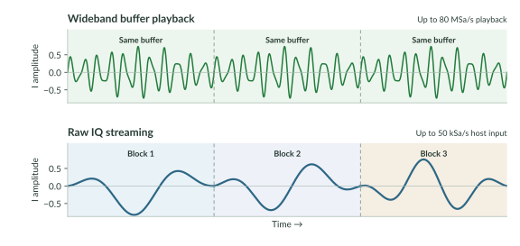
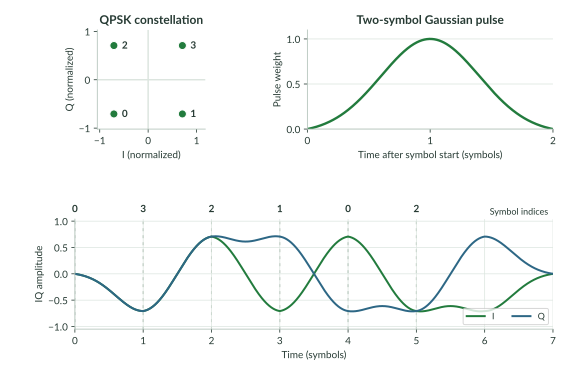
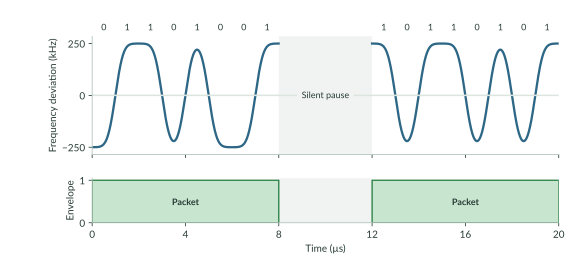

IQ Transmit Streaming
=====================

In :doc:`iq-transmission`, you load a waveform into each sensor's memory.
The sensors then repeat it on their own. This works well for a known signal
such as a test tone, even if its waveform needs a high sample rate. Use IQ
streaming when the data keeps changing, as with live audio. Your computer
sends new data to the controller, and the controller passes it to the sensors
before it is due to play.

   Stored playback can use wider-band waveforms because the sensors read
   samples from memory at up to 80 MSa/s. With Raw IQ streaming, the
   computer can send up to 50 kSa/s of fresh samples. The two digital modes
   send symbols or bits and build the waveform on the sensors.

You can stream one beam at a time. At lower input rates you can also play
stored waveforms on the same antennas.

See :doc:`iq-beam-steering` to schedule rapid changes of direction while a stream plays.

Input formats
-------------

The mode tells the sensor what the bytes mean. Choose it based on the data
your program produces. If it already produces a waveform, use Raw IQ. If it
produces symbols or packets, let the sensors make the waveform.

.. list-table::
   :header-rows: 1
   :widths: 20 47 33

   * - Mode
     - What the client reads
     - What the sensors do
   * - **Raw IQ**
     - One signed 8-bit I byte and one signed 8-bit Q byte per sample (CS8).
     - Reconstruct your waveform from samples supplied at the configured rate.
   * - **Single Carrier**
     - One unsigned byte per constellation index. The client packs indices
       on the wire.
     - Apply the configured pulse shape to each symbol.
   * - **GFSK**
     - A two-byte little-endian length, counting the bytes in the
       complete on-air packet that follows. Repeat for each packet.
     - Apply Gaussian FSK and insert the configured silent pause after
       each packet.

Raw IQ accepts 8, 16, 32, 40 or 50 kSa/s. Set the input rate to match the
file or producer, since a CS8 file stores only the samples. Use 8 kSa/s
when the same antennas also play a nonzero stored waveform. The sensors
interpolate the input to 500 kSa/s before 16 MSa/s playback. That
reconstruction can leave weaker copies of the signal spaced 500 kHz apart.

In the digital modes, the sensor fills in the playback samples for each
symbol. The highest usable rate depends on the modulation and pulse shape.
Use UDP for closely spaced bursts at high symbol rates.

Make a Raw IQ test file
-----------------------

This example writes a two-second tone for a stream configured at 8 kSa/s:

.. code-block:: python

   import numpy as np

   time = np.arange(2 * 8000) / 8000
   phase = 2 * np.pi * 1000 * time
   iq = 64 * np.column_stack((np.cos(phase), np.sin(phase)))
   np.rint(iq).astype(np.int8).tofile("samples.cs8")

The file contains 16,000 samples. Each row is written as an I byte followed
by a Q byte.

For single-sideband audio, use ``SSBEncoder`` to convert your audio to
complex samples at the Raw IQ input rate. Send the ``flush()`` output at
the end so the last part of the audio can play.

Stream a file from Python
-------------------------

Create a beam with a Stream source, then calibrate the transmitters.
Opening the beam gives you a writer for its samples.
This example sends the 8 kSa/s file above through the cabled reference
output. For an over-the-air test, select an antenna output and check the
:doc:`transmit authorization requirements <iq-transmission>`.

.. code-block:: python

   from espargos import Pool
   from espargos.stream_sources import Stream

   with Pool("192.168.1.2").open(transports=["udp"]) as pool:
       pool.configure(mode="iq_tx", frequency_hz=2_402_000_000,
                      sample_rate_hz=16_000_000, output="reference",
                      rf_gain={"a": 0, "b": 0})
       tx = pool.tx
       beam = tx.signals.add(waveform=Stream(sample_rate_hz=8000), amplitude=0.1)
       pool.calibrate(tx_method="monitor")

       with open("samples.cs8", "rb") as source, beam.open_stream() as stream:
           stream.write(source.read(2048))  # Prefill with 1,024 complex samples.
           pool.start_transmission()
           try:
               stream.start()
               while block := source.read(4096):
                   stream.write(block)
               stream.finish()
               stream.wait()
           finally:
               pool.stop_transmission()

Streaming supports cyclic buffer lengths of 256, 512, 1024 or 2048
samples. Keep the buffer length and RF settings fixed until the stream
closes. The source sets the input format. The beam sets amplitude, antenna
selection and steering, just as it does for a repeating waveform. Closing a
writer leaves the beam prepared for the next connection. See :doc:`iq-transmission` for more on
preparing waveforms and monitor calibration.

In Raw IQ mode, pass CS8 bytes, a two-column NumPy ``int8`` array or
normalized complex samples to ``write()``. Prefill at least 1,024 raw
samples, four Single Carrier indices or a GFSK packet before ``start()``.
For a finite stream, mark the end with ``finish()`` and call ``wait()`` to
let the remaining data play. See :class:`espargos.iq_stream.IQStream` for
the stream methods.

Single Carrier
--------------

Give the array a constellation table and a pulse shape. For each symbol,
send the index of the point you want to transmit. The sensor scales a copy
of the pulse by that point and adds it to any pulses still playing.

   The bytes 0, 3, 2, 1, 0, 2 select the numbered QPSK points. Each point
   scales a copy of the pulse. The sensor adds the overlapping pulses to
   produce the I and Q waveform shown below.

To use your own constellation and pulse, pass
``SingleCarrier(constellation, pulse, symbol_rate_hz=...)``. Use at most 64
points, each with magnitude at most one. For a pulse spanning ``span``
symbols, give ``span * samples_per_symbol + 1`` coefficients, including
both endpoints. A pulse can span 1 to 8 symbols at a table resolution of
16, 32, 64 or 128 samples per symbol. That resolution describes the shape
of the pulse. ``symbol_rate_hz`` sets how often a new pulse starts.

A short pulse and a small constellation allow the highest rates, up to
1.6 Mbaud. Each BPSK symbol costs one bit before transport framing, while a
64-QAM symbol costs six. Above 1 Mbaud, or above 1.6 Mbit/s of packed
symbols, keep any stored waveforms silent on the streaming antennas.

For text at 31.25 baud, use the PSK31 preset. It sets the two constellation
points, pulse shape and symbol rate. On the computer, ``psk31_symbols()``
turns your text into the point indices to send. Run the example while
the Raw IQ example’s calibrated pool is open and its writer is closed.
Assign the new source to the same beam.

.. code-block:: python

   from espargos.stream_sources import Stream, SingleCarrier, psk31_symbols

   beam.waveform = Stream(mode="single_carrier", modulation=SingleCarrier.psk31())
   with beam.open_stream() as stream:
       stream.write(psk31_symbols("cq test"))
       stream.finish()
       pool.start_transmission()
       try:
           stream.start()
           stream.wait()
       finally:
           pool.stop_transmission()

``psk31_symbols()`` generates one complete ASCII burst. For continuous text,
keep the differential encoder's state between writes.

.. _iq-streaming-gfsk:

GFSK packets
------------

In Gaussian frequency-shift keying (GFSK) mode, your program sends a
complete sequence of bits for each packet. The sensors generate the
frequency shifts and play the result as a burst. You set the silent interval
before the next burst. Use the LE 1M or LE 2M preset for Bluetooth LE, or
enter the modulation settings to match a different radio.

   The upper trace shows frequency deviation for short 1 Mbaud bursts.
   The pause follows each packet record, regardless of UDP or WebSocket
   message boundaries.

Send a Bluetooth LE advertisement
~~~~~~~~~~~~~~~~~~~~~~~~~~~~~~~~~

Use a non-connectable advertisement to try the LE 1M preset with a nearby
scanner. The preset sets the radio modulation. To build the bytes to send,
give ``ble_le1m_packet()`` the header and payload (the PDU), along with the
channel. It adds the preamble, access address and CRC, and applies the
channel's whitening sequence.

For a first test, tune the array to 2402 MHz, which is BLE advertising
channel 37. Use the preparation above with ``output="antenna_r"`` and
set a scanner to listen on channel 37. The example sends one legacy,
non-connectable advertisement with the local name ``Lab``. Repeat the
burst if you use a scanner that cycles through channels. Run the code
while the prepared pool is open.

.. code-block:: python

   from espargos.stream_sources import Stream, GFSK, ble_le1m_packet

   address = bytes.fromhex("01 00 00 00 00 C2")  # Static random address, LSB first
   flags = bytes([2, 0x01, 0x04])  # BR/EDR Not Supported
   name = bytes([4, 0x09]) + b"Lab"  # Complete Local Name
   payload = address + flags + name
   pdu = bytes([0x42, len(payload)]) + payload  # ADV_NONCONN_IND, random address

   air_packet = ble_le1m_packet(pdu, channel=37)
   beam.waveform = Stream(mode="gfsk", modulation=GFSK.le1m())
   with beam.open_stream() as stream:
       stream.write_packet(air_packet, gap_us=20_000)
       stream.finish()
       pool.start_transmission()
       try:
           stream.start()
           stream.wait()
       finally:
           pool.stop_transmission()

For LE 2M, use ``GFSK.le2m()`` and ``ble_le2m_packet()``. LE 2M uses data or
secondary advertising channels 0 through 36. The helper defaults to
channel 0 (2404 MHz). For connection packets, supply the connection's
access address and CRC initializer. Your application chooses the channel
and decides when to send each packet.

Custom GFSK settings
~~~~~~~~~~~~~~~~~~~~

A packet can contain up to 1,020 bytes. Its bits and the following pause
must fit within 65,536 symbol intervals. At 2 Mbaud, the packet length
and gap determine how much data the host must deliver. For example, eight
sensors played 251-byte packets with a 300 µs gap while steering every
8 ms. Shortening the gap to 150 µs caused an underrun in the same test.
Keep stored waveforms silent on the antennas carrying the 2 Mbaud stream.

If you are matching a radio other than Bluetooth LE, start with its symbol
rate and frequency deviation. The modulation index is twice the deviation
from the center frequency divided by the symbol rate. Gaussian BT controls
the smoothing. A lower BT makes the transitions more gradual. The
``GFSK`` constructor accepts BT from 0.2 to 1 and a filter span of two or
four symbols. Rates must divide 16 MSa/s exactly and lie between 125 kbaud
and 2 Mbaud. The constructor raises ``ValueError`` if the sensors cannot generate
the selected combination of rate, modulation index and span.

Buffer status and underruns
---------------------------

The client sends samples, indices or packets over the board's UDP or
WebSocket stream. Each sensor sends its buffer space, stream state and error
counters back in a cumulative ``TXSTREAM_STATUS`` report on that connection. The client prefills the sensors and schedules
a common start. By default ``start()`` allows half a second to deliver the
command, plus 50 ms for the sensors to prepare playback.
For live audio or a GUI, put writes on a worker thread. A write can wait
if any sensor runs low on buffer space.

Use ``stream.status()`` to see how many samples or symbols have reached
each sensor and how far it has played. Check ``missing`` separately for
gaps and ``clipped`` for samples outside the output range.

UDP uses packet offsets to keep later data aligned. Missing data becomes
silence and the client does not retransmit it. If the buffer runs dry, the
sensors stop that stream's contribution. New writes can fill a fresh session
and start together on the original symbol grid. Check ``stream.resumptions``
for the number of recoveries. A hardware refill fault or a sensor restart
requires you to prepare and calibrate again before resuming coherent TX.

Multiple arrays
---------------

When several boards form one antenna array, their sensors have to play
the same source samples at the same time. Connect them to the same clock,
then calibrate them together at the transmit frequency and rate. The shared
clock keeps their sample rates in step.
``pool.calibrate(tx_method="monitor")`` measures the timing and RF phase
differences across the selected boards. The master monitor needs an RF
path back from every participating transmitter. The amplifier-splitter supplied
with aperture kits passes REF in one direction and blocks that return path.
The SDK currently supports reciprocal TX calibration at 80 MSa/s. For 16 MSa/s
streaming across boards, use a bidirectional REF network for monitor calibration.

Use a single pool and stream for the whole array. Each controller needs
matching modulation settings and 16 MSa/s playback. Give the client all
of the controller addresses so it assigns a common start time and sample
offsets. For geometric steering, open the pool with the aperture layout.
See :doc:`combined-arrays` for the wiring and geometry.
