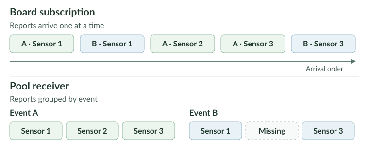

Boards and pools
=====================

:class:`Board <espargos.board.Board>` represents one ESPARGOS array. :class:`Pool <espargos.pool.Pool>` groups one or more boards
and owns their connections. The boards need not form a regular arrangement.
Use it as a context manager so that streams are closed and transmissions
stopped when your program leaves the block:

.. code-block:: python

   from espargos import Pool

   with Pool("192.168.1.2") as pool:
       pool.configure(mode="iq_rx", frequency_hz=2437e6)
       calibration = pool.calibrate()

You can also pass existing boards. The pool uses those exact objects and closes
them when it exits::

   from espargos import Board, Pool

   with Pool([Board("192.168.1.2"), Board("172.16.0.241")]) as pool:
       pool.configure(mode="wifi", channel=6)

No geometry is needed for reception or explicit per-antenna TX weights.
For an aperture kit, load the existing configuration file instead:

.. code-block:: python

   pool = Pool.from_config("config/aperture-kit-8x4.yml")

The file supplies board names, addresses, antenna geometry and reference-cable
information. Loading it does not connect to hardware, change modes or enable
transmission. Entering ``with pool:`` opens the connections. For a GUI, call
:meth:`pool.open() <espargos.pool.Pool.open>` and :meth:`pool.close() <espargos.pool.Pool.close>` explicitly from its hardware worker.
A pool cannot be reopened after closing it.

Choose antennas, then configure them
------------------------------------

A selection is a view of the same hardware. It neither opens new connections
nor owns a separate lifetime. Select boards by object, address, or the names
from the configuration file:

.. code-block:: python

   with Pool.from_config("config/aperture-kit-8x4.yml") as pool:
       receivers = pool.select(boards=["ba3", "ba4"])
       receivers.configure(mode="iq_rx", frequency_hz=2437e6)

Choose individual antennas with hardware IDs 0–7, rather than row/column
indices. IDs apply to each board in the selection:

.. code-block:: python

   selected = pool.select(boards="ba1", antennas=[0, 2, 5])
   selected.configure(mode="iq_rx", frequency_hz=2412e6)

Nested selections can only narrow the selected set. For different antenna
lists on different boards, pass explicit :class:`Antenna(host, antid) <espargos.calibration.Antenna>` identities.

:meth:`configure() <espargos.pool.AntennaSelection.configure>` changes the supplied fields on selected antennas. See :doc:`modes` for
the available roles, board-wide settings and an example of mixing roles.

Receive and transmit
---------------------

:attr:`pool.iq <espargos.pool.Pool.iq>`, :attr:`pool.wifi <espargos.pool.Pool.wifi>`,
:attr:`pool.wifi_iq <espargos.pool.Pool.wifi_iq>` and
:attr:`pool.ble <espargos.pool.Pool.ble>` provide shared receivers.
Use their callbacks and backlogs, with :class:`Pool <espargos.pool.Pool>` driving processing, as described in
:doc:`iq-reception`, :doc:`wifi-reception`, :doc:`wifi-iq-reception` and :doc:`ble-reception`. They use the same board connections,
and :class:`Pool <espargos.pool.Pool>` manages their lifetime.

WiFi packet transmission also uses :attr:`pool.wifi <espargos.pool.Pool.wifi>`, as described in
:doc:`wifi-transmission`.

:attr:`pool.tx <espargos.pool.Pool.tx>` provides waveform and beam controls, described in
:doc:`iq-transmission`. For live sources, see :doc:`iq-transmit-streaming`.
Both use the pool's connections and IQ receiver.
Beamspace steering across boards requires geometry from :meth:`from_config() <espargos.pool.Pool.from_config>`.
A :class:`Pool <espargos.pool.Pool>` built from addresses alone can still use explicit per-antenna
complex weights.
Creating these TX controls mutes transmission. Preparing a waveform does not
start it. Use :meth:`selection.start_transmission() <espargos.pool.AntennaSelection.start_transmission>` and
:meth:`selection.stop_transmission() <espargos.pool.AntennaSelection.stop_transmission>` to control selected transmitters. Stop sends
silence while replay continues, preserving calibration.

These calls are blocking. GUI applications should serialize hardware operations
on a worker thread, as the demos do. Do not close individual boards or shared
receivers while other parts of your application are using the pool.

Calibrate the configured roles
------------------------------

:meth:`pool.calibrate() <espargos.pool.Pool.calibrate>` examines the current modes. It calibrates reception for
WiFi/IQ RX antennas and transmission for IQ TX antennas, returning a
:class:`Calibration <espargos.calibration.Calibration>`. :meth:`selection.calibrate() <espargos.pool.AntennaSelection.calibrate>` returns only the requested antenna
coverage. Recalibration must include each overlapping calibration group in
full. Using a subset without recalibrating is always allowed.
Successful results are also merged into :attr:`pool.calibrations <espargos.pool.Pool.calibrations>`.

TX uses reciprocal sensor measurements by default. Select
``tx_method="monitor"`` for a bidirectional REF path to the controller, or
``path="antenna_r"`` / ``"antenna_l"`` for OTA reciprocal measurements.

IQ calibration requires a common frequency and RX sample rate within the
selection. Sensors outside it keep their modes, tuning and stored corrections.
Shared capture controls and transmission pause during the measurement.
Subgroup recalibration reuses an existing sample grid at 80 MSa/s. See
:doc:`calibration` for initial synchronization and independent group references.
WiFi calibration can measure multiple channel groups without retuning receivers.

Saved calibration is bound to the hardware state in which it was measured.
Changing modes or retuning can invalidate it. See :doc:`calibration` for group
references, subset selection and validity checks.

Reports and measurements
------------------------

Subscribe on a board if you want to inspect one antenna's capture as soon
as it arrives. For example, ``board.ble.subscribe_packets()`` gives you each
sensor's samples and metadata separately. Subscribe on the pool receiver
when you need the antennas that observed the same event. For direction
finding, that grouping keeps a late report from one packet from being
mistaken for part of the next.

   Reports for two events arrive interleaved. The pool groups them by
   event and keeps a gap for the sensor that missed event B.

Keep callbacks short because receivers share a worker. If a callback accepts
an incomplete measurement early, copy the fields you want to keep. More
antenna reports may still arrive. The receiver backlogs keep selected fields
from delivered measurements. If your recorder falls behind, inspect
``buffer_stats.dropped`` and ``buffer_stats.expired`` and adjust its receiver's
``configure_buffering(BufferPolicy(...))`` settings.

Connection ownership
--------------------

Only :class:`Pool <espargos.pool.Pool>` starts, reconnects and closes board streams. Its registered
receivers assemble incoming messages. :meth:`pool.start_processing() <espargos.pool.Pool.start_processing>` runs their
callbacks on one shared worker, including receivers first accessed after the
worker starts. :meth:`pool.stop_processing() <espargos.pool.Pool.stop_processing>` stops that worker without closing
connections. Receivers have no independent start, stop or close operation.
Backlog ``close()`` only removes its callback. IQ/WiFi calibration groups live in
:attr:`pool.calibrations <espargos.pool.Pool.calibrations>`. Narrowband BLE phase
calibration is managed by ``pool.ble``, as described in :doc:`ble-reception`.

CSI getters that return one pool-wide value raise ``ValueError`` when boards
disagree. They never change settings. Read individual :class:`Board <espargos.board.Board>` capabilities
when different settings are intentional, or explicitly set a common value.
